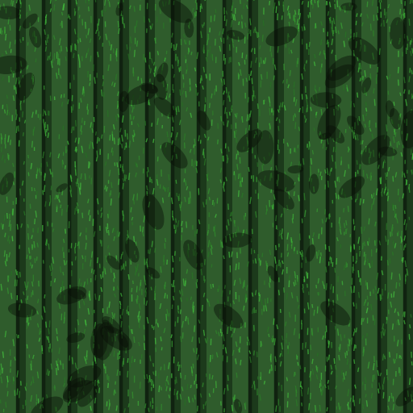
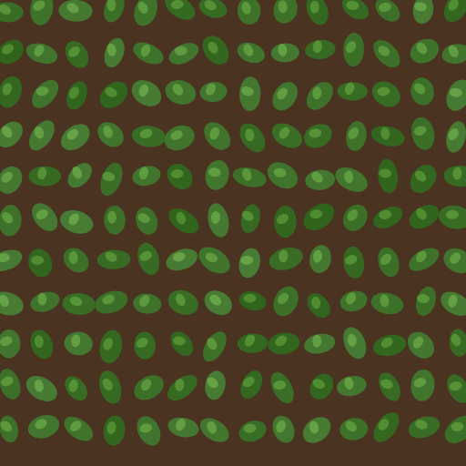
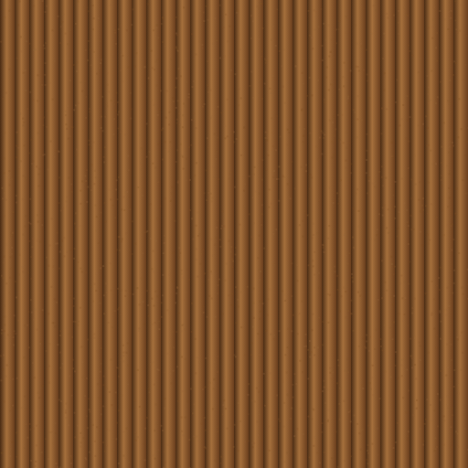
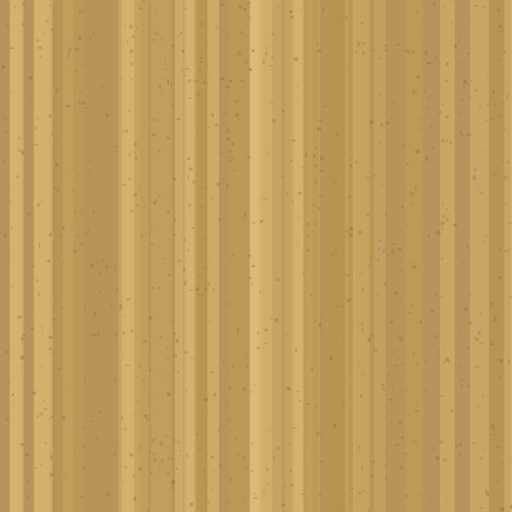
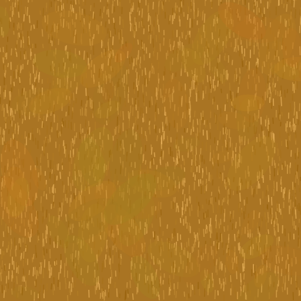
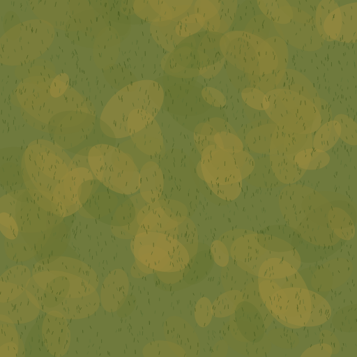

# PlanLift — 10 Editor Features: Full Source Export

Exported from `app/public/editor.html` (a single-file vanilla-JS + Three.js r163 editor — no framework, no build step) for porting the same 10 features into another codebase. Every code block below is copied **verbatim** from the working, tested source, with the original line numbers noted for cross-reference.

> Give this whole file to a fresh Claude session working in the target project. It explains the shared architecture these features all depend on, then gives each feature's complete code in isolation.

---

## 0. Architecture you must have (or adapt) before any of this works

This editor's own conventions that every feature below assumes:

1. **A single flat array `_elements[]`** holds every placed thing (walls, doors, pillars, poles, railings, roads, trees, bushes …), each a plain object with at least `{id, type, x1, y1, x2, y2, source}` in **image-pixel space** (not world/meters). `type` is the discriminator (`'wall'`, `'pole'`, `'railing'`, `'road'`, `'tree'`, `'bush'`, …).
2. **`pos(px, py) => [worldX, worldZ]`** converts an image-pixel coordinate to Three.js world X/Z, centered on the building. Defined inside the 3D-build function as:
```js
  // wall it's on).
  const sharedGlassPaneMat = pbrGlassWall();
  const sharedGlassFrameMat = pbrGlassFrame();

  const wallMatName=document.querySelector('input[name="wallMat"]:checked')?.value||'brick';
  const allMeshes=[];
  const floorGroups=[];
  const pos=(px,py)=>[px*S-FW/2, py*S-FD/2];

  // Per-opening/per-wall geometry, collected across all floors, so the
  // opening-selection gizmo/drag code (which runs after build3D() returns)
```

   `S` is pixels-per-world-unit (real meters/px once the plan is calibrated, a proportional fallback otherwise), `FW`/`FD` are the whole building's width/depth in world units.
3. **Click-to-chain drawing** (Wall/Railing/Road) is a 2-click gesture, not hold-drag-release: first click sets `edit.drawStart`, mouse moves freely (no button held) updating `edit.drawCurrent` for a live preview, second click commits the segment and re-arms `drawStart` from the new endpoint so the chain continues. This was a real bug fixed mid-session — a hold-drag interaction reads as "click, release, move, click" to a user already trained on every other tool being click-click, and silently resets instead of ever finishing.
4. **Click-click rectangle tools** (Pond/Hangar/Building/Land rectangle mode) are the same 2-click idea but one-shot (not a chain): click corner 1, click the opposite corner, done.
5. **`getTex(name)` / `makeTex(name)`** — a procedural canvas-texture cache. `getTex` returns a cached `THREE.CanvasTexture`; the first call lazily builds it via `makeTex`, a big if/else chain that draws a 512×512 pattern onto a `<canvas>` with plain 2D context calls (fillRect/ellipse/strokes with `Math.random()` noise), never real image files:
```js
const _texCache   = {};
```

```js
function getTex(n){if(!_texCache[n])_texCache[n]=makeTex(n);return _texCache[n];}
```

   Whenever a NEW mesh needs its own independent tiling (`repeat`/`wrapS`/`wrapT`), `.clone()` the cached texture first — mutating the shared cached original would affect every other user of that texture name.
6. **`isWall`, `isLineEl`, `isWallDrawTool`, `isRailingDrawTool`** — the small predicate helpers that let Railing/Road piggyback on Wall's endpoint-drag/hit-testing code without being full wall-corner-graph members:
```js
const isWall = el => el.type === 'wall';
// Selection/editing (handles, hit-testing, endpoint drag) treats a railing/
// fence exactly like a wall — a line from x1/y1 to x2/y2, not a box — since
// that's what it actually is on the plan, same as a wall. Neither
// el.corner1 nor el.corner2 are ever set on a railing (it's deliberately
// not part of the wall corner-graph — see the Railing tool's own drawing
// code), so reusing the wall drag-apply code for it is safe: every branch
// there already falls back to a plain x1/y1/x2/y2 update whenever
// corner1/corner2 is null, exactly the railing case.
const isLineEl = el => isWall(el) || el.type==='railing' || el.type==='road';
// The Glass Wall tool is the exact same click-to-chain/drag drawing
// interaction as the regular Wall tool — every place that gates on
// edit.tool==='wall' to run that interaction also needs to run it for
// 'wallGlass'. Only the element-creation sites additionally check
// edit.tool==='wallGlass' specifically, to tag the new wall el.wallMat.
const isWallDrawTool = t => t==='wall' || t==='wallGlass';
// Same idea for the Railing tool and its Barbed Wire Fence variant — both
// draw click-to-chain 'railing' elements, just with a different
// el.railingStyle tag (undefined/'glass' = the existing steel-post/top-
// rail/glass-infill look, 'barbed_wire' = concrete posts + wire strands).
// The Road tool reuses the exact same click-to-chain interaction (every
// call site below stays shared) but creates a separate el.type==='road'
// at the one creation site that actually branches per-tool — see that
// branch for why it can't just be another el.railingStyle value: a road
// needs a real drawn WIDTH (el.thickness, like a wall) and a flat
// ground-hugging 3D look, neither of which the railing/fence look fits.
const isRailingDrawTool = t => t==='railing' || t==='fenceBarbed' || t==='road';
const wallThick = el => el.thickness || DEFAULT_WALL_THICK;
const wallAngle = el => Math.atan2(el.y2-el.y1, el.x2-el.x1);
const wallLen   = el => Math.hypot(el.x2-el.x1, el.y2-el.y1);
const wallMid   = el => ({x:(el.x1+el.x2)/2, y:(el.y1+el.y2)/2});
```

7. **`_pointInPolygon(px, py, pts)`** — even-odd ray-casting hit test, used to click-select a freeform (non-rectangular) shape like a Land patch:
```js
function _pointInPolygon(px, py, pts){
  let inside = false;
  for(let i=0, j=pts.length-1; i<pts.length; j=i++){
    const xi=pts[i].x, yi=pts[i].y, xj=pts[j].x, yj=pts[j].y;
    const intersect = ((yi>py) !== (yj>py)) && (px < (xj-xi)*(py-yi)/(yj-yi)+xi);
    if(intersect) inside = !inside;
  }
  return inside;
}
function _roomsTabActive(){
  return document.getElementById('tabRooms').classList.contains('active');
}
```

8. **A THREE.Shape built from `pos()` world points and laid flat via `mesh.rotation.x = -Math.PI/2`** needs its local Y set to **`-worldZ`**, not `+worldZ` — this convention shows up in every flat-shape mesh below (Pond water, Land patches). Get this sign wrong and the shape still renders, just mirrored/offset.
9. **`⚠️ REAL BUG, now fixed, worth knowing before you copy the Land/groundMat tiling code**: `THREE.ShapeGeometry` does **not** give 0..1-normalized UVs the way `THREE.PlaneGeometry` does — confirmed straight from three.js's own source (`ShapeGeometry.js`: `uvs.push(vertex.x, vertex.y); // world uvs`). u/v are the shape's raw **world-space** coordinates. So `texture.repeat` must be a **constant** (`1 / metresPerTile`), not scaled by the shape's own span — scaling by span (the natural-looking first attempt) makes tiling worse the "denser" you try to make it, because it's already off by a factor of the span itself. This bit both the Land tool's own patches and the ground-floor `groundMat` option below; the code already reflects the fix.
10. **Draw-state variables always come in this quintet per tool**: `_XDrawMode` (bool), `_XDrawStart`/`_XDrawCurrent` ({x,y} image-space, while the 2-click gesture is in progress), and for freeform-capable tools `_XFreeformMode`/`_XFreeformPts`/`_XFreeformHover`.
11. **`markStale()`** flags the 3D view as needing a rebuild (and rebuilds immediately if the 3D tab is already open); call it after any data change instead of manually re-running the whole 3D build.
12. All 3D generation lives inside one big function (here called `renderFloorLevel`, invoked once per floor from `build3D()`), which already has `group` (the THREE.Group everything gets added to), `allMeshes` (flat array every mesh gets pushed into, for later export bookkeeping), `yBase` (this floor's world Y), `mpp` (meters-per-pixel if calibrated, else null), `WALL_H` (a proportional-fallback wall height constant), and `pos()` all already in scope — the code below relies on all of them.

---
## 1. Pole (Build panel)

A standalone vertical post — round, slender, fixed real-world radius regardless of how big a footprint was dragged (only the drawn *centre* point is used). Height is adjustable afterward via the generic `el.heightM` field every element already has.

**Toolbar button** (`app/public/editor.html:1138`):
```html
                <button class="tool-btn" data-tool="pole" title="Draw Pole — drag to place; a fixed slender real-world post, only Height is adjustable afterward in the properties bar">❚<span>Pole</span></button>
```


**Creation**: reuses the fully generic drag-rectangle-creates-an-element path shared with Pillar/Mezzanine/Stairs — see §12 "Shared generic single-drag creation" below. No pole-specific mousedown/mouseup code exists; it Just Works once the tool button sets `edit.tool='pole'`.

**3D generation** (part of the big per-element if/else chain in `renderFloorLevel`):
```js
      }else if(el.type==='pole'){
        // Standalone vertical post — round and slender, unlike Pillar's
        // square structural column, for a flagpole/lamp-post/fence-corner-
        // post look. Radius is a FIXED real-world size (6cm — a typical
        // sturdy post/flagpole diameter), same reasoning as Pillar's fixed
        // cross-section above: only the drawn CENTRE (cx,cz) is used, not
        // bw/bd, so it can't come out unrealistically fat or toothpick-thin
        // depending on how big a footprint was dragged. Height is fully
        // adjustable via the exact same generic el.heightM field Pillar
        // already uses (see the branch just above) — no pole-specific
        // height plumbing needed, it's already editable in the properties
        // bar's Height field like any element.
        let elH = WALL_H;
        if(el.heightM){
          elH = mpp ? el.heightM : WALL_H*(el.heightM/2.5);
          elH = Math.max(0.1, elH);
        }
        const poleR = mpp ? 0.06 : WALL_H*0.024;
        const matKey=(el.wallMat&&el.wallMat!=='auto')?el.wallMat:'steel';
        const tc=getTex(matKey).clone();tc.needsUpdate=true;tc.wrapS=tc.wrapT=THREE.RepeatWrapping;
        tc.repeat.set(1, Math.max(1,elH/1.2));
        mesh=new THREE.Mesh(
          new THREE.CylinderGeometry(poleR,poleR,elH,12),
          matKey==='steel'
            ? new THREE.MeshStandardMaterial({map:tc,color:0xffffff,metalness:0.5,roughness:0.4})
            : new THREE.MeshLambertMaterial({map:tc,color:0xffffff})
        );
        if(matKey==='steel'){
          mesh.material.name='PlanLift_Steel';
          mesh.name='PlanLift_Steel_Pole';
        }
        mesh.position.set(cx,yBase+elH/2,cz);

```

## 2. Fence / Railing (Build panel)

Click-to-chain like Wall (§0.3). One `type:'railing'` element per clicked segment; `el.railingStyle` picks the look — `undefined`/`'glass'` = steel posts + top rail + glass infill, `'barbed_wire'` = concrete posts + wire strands (the "Fence" toolbar button sets this). Deliberately NOT part of the wall corner-graph (no `corner1`/`corner2`) — a railing can run anywhere, not just around a closed room.

**Toolbar buttons** (`:1143-1144`):
```html
                <button class="tool-btn" data-tool="railing" title="Draw Railing (click-to-chain, like Wall) — circular steel posts, top rail, and glass infill. Doesn't need to close into a loop; right-click or switch tools to stop.">🛡<span>Railing</span></button>
                <button class="tool-btn" data-tool="fenceBarbed" title="Draw Barbed Wire Fence (click-to-chain, like Wall) — concrete posts with strands of barbed wire between them. Doesn't need to close into a loop; right-click or switch tools to stop.">🔗<span>Fence</span></button>
```


**Railing-height mini control** in the Rooms/Labelling sidebar (`:1046-1054`):
```html
                <b>🛡 Railing</b>
                <p class="lr-hint">Draw railing itself from the Edit tab's 🧱 Build panel (click-to-chain, same as the Wall tool — doesn't need to close into a loop). This just sets the height applied to it.</p>
                <div style="display:flex;align-items:center;gap:6px">
                  <span style="font-size:10px;color:rgba(255,255,255,.4);white-space:nowrap">Railing height</span>
                  <input class="dim-input" type="number" id="railHeightInput" value="1.0" min="0.4" max="2" step="0.05" style="width:56px"/>
                  <select class="dim-select" id="railHeightUnit" style="width:50px">
                    <option value="m">m</option><option value="ft">ft</option>
                  </select>
                  <button type="button" id="btnApplyRailHeight" class="ht-btn">Set</button>
```


**Click-chain creation** — shared mousedown branch with Road, see §3 below (both live in the same `if(isRailingDrawTool(edit.tool))` block).

**2D rendering** — a real line (not a box), so it needs its own draw function instead of the generic rotated-rect one:
```js
function _drawRailingPoly(el, sel){
  const color = el.railingStyle==='barbed_wire' ? '#b45309' : '#67e8f9';
  ectx.save();
  ectx.strokeStyle = sel ? '#2563eb' : color;
  ectx.lineWidth = sel ? 4 : 3;
  if(el.source==='manual') ectx.setLineDash([8,4]);
  ectx.beginPath();
  ectx.moveTo(el.x1,el.y1); ectx.lineTo(el.x2,el.y2);
  ectx.stroke();
  ectx.setLineDash([]);
  ectx.fillStyle = sel ? '#2563eb' : color;
  [[el.x1,el.y1],[el.x2,el.y2]].forEach(([px,py])=>{
    ectx.beginPath(); ectx.arc(px,py,4,0,Math.PI*2); ectx.fill();
  });
  ectx.restore();
}

// A road/driveway — a real-WIDTH paved strip (el.thickness, same property
// wall thickness lives in) with a dashed centre line, drawn via canvas's
// own thick-stroke instead of a hand-built offset polygon (same technique
// _drawWallPolyRaw already uses for walls).
```


**3D generation** (posts + top rail + glass or wire infill, spaced along the run):
```js
    // Railing elements — drawn like walls (click-to-chain in the Build
    // panel's 🛡 Railing / 🔗 Fence tools, one el per segment, doesn't need
    // to close into a loop), independent of floor openings entirely: a
    // railing/fence can run along a balcony edge, a property line, inside a
    // room, anywhere — not just around a cut hole. el.railingStyle picks
    // the look: undefined/'glass' = circular steel posts + top rail + glass
    // infill (glass reuses _glassMat(), same material the wall-glass toggle
    // uses, so it exports to Isaac Sim as real glass with no extra backend
    // work); 'barbed_wire' = square concrete posts + several taut wire
    // strands between them, no infill — a perimeter/agricultural fence
    // rather than a balcony guard.
    const railingEls = elements.filter(e=>e.type==='railing');
    if(railingEls.length){
      const RAIL_H = mpp ? _railHeightM : WALL_H*0.35*(_railHeightM/1.0); // proportional fallback when uncalibrated, same convention as WALL_H itself
      const POST_R = Math.max(0.015, RAIL_H*0.02);
      const RAIL_R = Math.max(0.02, RAIL_H*0.025);
      const POST_SPACING = Math.max(0.6, mpp ? 1.2 : RAIL_H*1.2);
      const steelMat = new THREE.MeshStandardMaterial({color:0xc8ccd1, metalness:0.85, roughness:0.25});
      // Barbed-wire fence look: chunky matte-grey concrete posts, thin dark
      // rusty-metal wire strands — deliberately NOT metallic/glossy like
      // steelMat, so it reads as concrete rather than steel.
      const CONCRETE_POST_HALF = Math.max(0.05, RAIL_H*0.06);
      const WIRE_R = Math.max(0.004, RAIL_H*0.006);
      const FENCE_POST_SPACING = Math.max(1.5, mpp ? 2.5 : RAIL_H*2.5);
      const concreteMat = new THREE.MeshStandardMaterial({color:0x9a988f, metalness:0, roughness:0.95});
      const wireMat = new THREE.MeshStandardMaterial({color:0x4b4640, metalness:0.5, roughness:0.6});
      const WIRE_HEIGHT_FRACS = [0.22, 0.44, 0.66, 0.9]; // 4 strands, evenly spread up the post
      const railGroup = new THREE.Group();
      const _up = new THREE.Vector3(0,1,0), _xAxis = new THREE.Vector3(1,0,0);
      // Adjacent chained elements share an endpoint (click-to-chain, like
      // walls) — collect posts by rounded world position first so a joint
      // between two segments gets exactly one post, not two overlapping
      // ones, then place them all in a second pass. Keyed to the style too,
      // so a glass-railing run and a barbed-wire run never fight over which
      // post look wins at a shared point (an edge case in practice, but
      // free to handle correctly here).
      const postKeys = new Map(); // "x,z" -> style
      const _queuePost = (wx,wz,style) => postKeys.set(wx.toFixed(3)+','+wz.toFixed(3), style);

      // World-space centre + half-width of every door/gate opening hosted
      // on ANY fence element, computed once up front — NOT scoped to just
      // the one railing element each is nominally "hosted" on. Click-to-
      // chain drawing (Wall tool, and Fence the same way) creates a
      // SEPARATE element per segment even when it feels like one
      // continuous line while drawing it — a wide gate (a Farm Gate/Wood
      // Gate is 3-4m) can easily span past the single short segment it
      // snapped nearest to and overlap into the NEXT chained segment,
      // which had no idea it needed to open up too. Checking every wire
      // sub-segment's own world-space midpoint against this list (instead
      // of only wallOpenings.get(thisElementId)) fixes that regardless of
      // which specific segment ended up hosting the door.
      const fenceOpeningsWorld = [];
      elements.filter(e=>e.type==='door'||e.type==='window').forEach(o=>{
        const hostId = openingWallMap.get(o.id);
        if(hostId==null) return;
        const host = elements.find(e=>e.id===hostId && e.type==='railing');
        if(!host) return;
        const geom = openingGeom.get(o.id);
        if(!geom) return;
        const [hax,haz]=pos(host.x1,host.y1), [hbx,hbz]=pos(host.x2,host.y2);
        const hlen=Math.hypot(hbx-hax,hbz-haz); if(hlen<0.05) return;
        const ux=(hbx-hax)/hlen, uz=(hbz-haz)/hlen;
        fenceOpeningsWorld.push({
          wx: hax+ux*geom.along3d, wz: haz+uz*geom.along3d, halfW3d: geom.halfW3d,
        });
      });

      railingEls.forEach(el=>{
        const isBarbed = el.railingStyle==='barbed_wire';
        const [ax,az]=pos(el.x1,el.y1), [bx,bz]=pos(el.x2,el.y2);
        const dx=bx-ax, dz=bz-az, edgeLen=Math.hypot(dx,dz);
        if(edgeLen<0.05) return;
        const dir=new THREE.Vector3(dx/edgeLen,0,dz/edgeLen);
        const railQuat=new THREE.Quaternion().setFromUnitVectors(_up,dir);
        const glassQuat=new THREE.Quaternion().setFromUnitVectors(_xAxis,dir);
        const spacing = isBarbed ? FENCE_POST_SPACING : POST_SPACING;
        const segCount=Math.max(1, Math.round(edgeLen/spacing));
        const segLen=edgeLen/segCount;

        // Checked against fenceOpeningsWorld (built above, across ALL fence
        // elements) in absolute world space — a point on THIS element that
        // falls within any nearby gate's radius gets skipped, whether the
        // gate is technically "hosted" on this exact element or the one
        // before/after it in the same click-to-chain run.
        const _pointInGap = (wx,wz) => fenceOpeningsWorld.some(o=>
          Math.hypot(wx-o.wx, wz-o.wz) < o.halfW3d+0.05);
        const _spanInGap = (from,to) => {
          const midT=((from+to)/2)/edgeLen;
          return _pointInGap(ax+dx*midT, az+dz*midT);
        };

        _queuePost(ax, az, el.railingStyle);
        for(let s=0; s<segCount; s++){
          const midT=(s+0.5)/segCount, midX=ax+dx*midT, midZ=az+dz*midT;
          const endT=(s+1)/segCount;
          const segStart=s*segLen, segEnd=(s+1)*segLen;
          // Only place the boundary post if it isn't itself inside a gap —
          // otherwise a regular-interval post can end up floating in the
          // middle of an open gate.
          if(!_spanInGap(segEnd,segEnd)) _queuePost(ax+dx*endT, az+dz*endT, el.railingStyle);
          if(_spanInGap(segStart,segEnd)) continue; // leave this segment open

          if(isBarbed){
            WIRE_HEIGHT_FRACS.forEach(f=>{
              const wire=new THREE.Mesh(new THREE.CylinderGeometry(WIRE_R,WIRE_R,segLen,6), wireMat);
              wire.quaternion.copy(railQuat);
              wire.position.set(midX, yBase+RAIL_H*f, midZ);
              wire.castShadow=true;
              railGroup.add(wire); allMeshes.push(wire);
            });
          } else {
            const railSeg=new THREE.Mesh(new THREE.CylinderGeometry(RAIL_R,RAIL_R,segLen,8), steelMat);
            railSeg.quaternion.copy(railQuat);
            railSeg.position.set(midX, yBase+RAIL_H, midZ);
            railSeg.castShadow=true;
            railGroup.add(railSeg); allMeshes.push(railSeg);

            const glassH=RAIL_H*0.92;
            const glassSeg=new THREE.Mesh(new THREE.PlaneGeometry(segLen*0.94, glassH), _glassMat());
            glassSeg.quaternion.copy(glassQuat);
            glassSeg.position.set(midX, yBase+glassH/2, midZ);
            railGroup.add(glassSeg); allMeshes.push(glassSeg);
          }
        }
      });

      postKeys.forEach((style,key)=>{
        const [wx,wz] = key.split(',').map(Number);
        let post;
        if(style==='barbed_wire'){
          post = new THREE.Mesh(new THREE.BoxGeometry(CONCRETE_POST_HALF,RAIL_H,CONCRETE_POST_HALF), concreteMat);
        } else {
          post = new THREE.Mesh(new THREE.CylinderGeometry(POST_R,POST_R,RAIL_H,8), steelMat);
        }
        post.position.set(wx, yBase+RAIL_H/2, wz);
        post.castShadow = true;
        railGroup.add(post); allMeshes.push(post);
      });
      group.add(railGroup);
    }
```

## 3. Road (Build panel, with adjustable width)

Also click-to-chain (shares the exact same interaction as Railing — same mousedown branch, just tagged `type:'road'` instead of `'railing'`), but rendered completely differently: a flat, ground-hugging paved strip with a dashed centre line, not a vertical post/rail structure. **The road's width lives in `el.thickness`** — the *same property a wall's thickness lives in* — specifically so the existing per-wall thickness-adjustment machinery (hit-test margin, resize handles) works on a road for free.

**Toolbar button** (`:1145`):
```html
                <button class="tool-btn" data-tool="road" title="Draw Road (click-to-chain, like Wall) — a real-width paved strip with a dashed centre line. Doesn't need to close into a loop; right-click or switch tools to stop.">🛣<span>Road</span></button>
```


**Default width helper** (4.5m when calibrated):
```js
// "proportional fallback" convention as every other real-world-size
// constant in this file (RAIL_H, POST_SPACING, …) when it isn't.
function _defaultRoadWidthPx(){
  const mpp=getMpp();
  return mpp ? (4.5/mpp) : DEFAULT_WALL_THICK*6;
}

// ── Wall polygon helpers ──────────────────────────────────────────────

```


**Shared click-chain creation with Railing** (mousedown handler, Edit tab) — note the `isRoad` branch that tags `el.type='road'` and sets its width from the helper above instead of `'railing'`:
```js
  if(isWallDrawTool(edit.tool)){
    // Click-to-chain: first click starts, subsequent clicks place wall + continue
    const sp=_snapPoint(x,y);
    if(!edit.drawing){
      snapElements();
      edit.drawing=true; edit.drawStart={x:sp.x,y:sp.y}; edit.drawCurrent={x:sp.x,y:sp.y};
    } else {
      // Place wall from drawStart → snapped point, continue chain from end
      const {x:sx,y:sy}=edit.drawStart, ex=sp.x, ey=sp.y;
      if(Math.hypot(ex-sx,ey-sy)>8){
        const thick=_getNewWallThick();
        const sIdx=isFloorMode()?_activeEditFloor:(_sections.length?0:undefined);
        const c1=_findOrCreateCorner(sx,sy), c2=_findOrCreateCorner(ex,ey);
        const el={id:_elIdCounter++,type:'wall',x1:c1.x,y1:c1.y,x2:c2.x,y2:c2.y,
                  corner1:c1.id,corner2:c2.id,thickness:thick,source:'manual'};
        if(edit.tool==='wallGlass') el.wallMat='glass_wall';
        if(sIdx!==undefined) el.sectionIdx=sIdx;
        if(_totalFloors>=2) el.floorNum=_selectedMgrFloor;
        _elements.push(el); _setSelection([_elements.length-1]);
        _commitCorners(); // derive corners only — _splitAtTJunctions is import-only
        renderEditCanvas(); updateSidebar(); renderElList(); markStale();
      }
      edit.drawStart={x:ex,y:ey}; edit.drawCurrent={x:ex,y:ey};
    }
    return;
  }
  if(isRailingDrawTool(edit.tool)){
    // Same click-to-chain interaction as the Wall tool above — one railing
    // segment per click, chain continues from the new endpoint, no need to
    // close into a loop (Escape / switch tool to stop). Deliberately NOT
    // using _findOrCreateCorner/_commitCorners — a railing isn't part of
    // the wall corner-graph, it can run anywhere (balcony edge, around an
    // opening, inside a room), so it stays a plain x1/y1/x2/y2 element like
    // pillar/mezzanine/stairs, just snapped to nearby points for alignment.
    const sp=_snapPoint(x,y);
    if(!edit.drawing){
      snapElements();
      edit.drawing=true; edit.drawStart={x:sp.x,y:sp.y}; edit.drawCurrent={x:sp.x,y:sp.y};
    } else {
      const {x:sx,y:sy}=edit.drawStart, ex=sp.x, ey=sp.y;
      if(Math.hypot(ex-sx,ey-sy)>8){
        const sIdx=isFloorMode()?_activeEditFloor:(_sections.length?0:undefined);
        const isRoad=edit.tool==='road';
        const el={id:_elIdCounter++,type:isRoad?'road':'railing',x1:sx,y1:sy,x2:ex,y2:ey,source:'manual'};
        if(edit.tool==='fenceBarbed') el.railingStyle='barbed_wire';
        // Reuses el.thickness — the exact same property a wall's width
        // lives in — rather than a new road-specific field, so every piece
        // of shared line-element machinery that already reads wallThick(el)
        // (hit-test margin, resize handles, drag-apply) works for a road
        // with no extra plumbing.
        if(isRoad) el.thickness=_defaultRoadWidthPx();
        if(sIdx!==undefined) el.sectionIdx=sIdx;
        if(_totalFloors>=2) el.floorNum=_selectedMgrFloor;
        _elements.push(el); _setSelection([_elements.length-1]);
        renderEditCanvas(); updateSidebar(); renderElList(); markStale();
      }
      edit.drawStart={x:ex,y:ey}; edit.drawCurrent={x:ex,y:ey};
    }
    return;
  }
```


**Mousemove**: full wiring is the generic "update `edit.drawCurrent` while `edit.drawing`" path already shown for Wall/Railing — Road piggybacks on `isRailingDrawTool`, see §0.6.

**Mouseup guard** — click-chain tools are fully self-contained in mousedown, so mouseup for these tools must do *nothing* (the very top of the mouseup handler):
```js
editCanvas.addEventListener('mouseup', e=>{
  if(e.button!==0 || _panning) return;
  // Railing's click-to-chain (like wall's) is fully self-contained in the
  // mousedown handler — it commits a segment and re-arms drawStart/
  // drawCurrent for the next click there directly, so mouseup must do
  // nothing at all for this tool (the same drag-rectangle-tools fallback
  // below would otherwise see drawStart===drawCurrent from a plain click
  // and reset edit.drawing to false, breaking the chain after one click).
  if(isRailingDrawTool(edit.tool)) return;
```


### Width-adjustment UI — a DEDICATED input, not reused

**⚠️ Real bug, now fixed**: Road width and Wall/Building thickness originally shared one physical `<input>` (just relabeled per context). Wall thickness is a few inches; road width is hundreds of inches once calibrated — switching between contexts left a stale huge/tiny value contaminating the other. **Give Road its own separate field.**

HTML (a second, independent status-bar control next to the wall-thickness one, `:900-923`):
```html
            <span id="statusSelected">Nothing selected</span>
            <!-- Wall thickness control — shown when a wall is selected -->
            <span id="wallThickControl" style="display:none;align-items:center;gap:6px;margin-left:12px;padding-left:12px;border-left:1px solid rgba(255,255,255,.1)">
              <span style="color:rgba(255,255,255,.45);font-size:10px;font-weight:700;text-transform:uppercase;letter-spacing:.5px">Thickness</span>
              <input id="wallThickInput" type="number" min="0.1" max="48" step="0.1" value="4"
                style="width:52px;background:rgba(255,255,255,.08);border:1px solid rgba(255,255,255,.15);border-radius:5px;padding:2px 6px;font-size:11px;font-weight:700;color:#60a5fa;font-family:inherit;outline:none;text-align:center"/>
              <span style="color:rgba(255,255,255,.35);font-size:10px" id="wallThickUnit">in</span>
            </span>
            <!-- Road width control — a SEPARATE input/id from wallThickControl on
                 purpose, even though both ultimately edit el.thickness: sharing one
                 physical field between "a few inches" (wall) and "hundreds of
                 inches" (road) scales left a stale huge/tiny leftover value from
                 whichever context was used last, contaminating the other the next
                 time it showed — confirmed live as both "typing a new road width
                 doesn't stick" and, separately, a Building's walls coming out too
                 thick to render sensibly in 3D right after adjusting a road's width. -->
            <span id="roadWidthControl" style="display:none;align-items:center;gap:6px;margin-left:12px;padding-left:12px;border-left:1px solid rgba(255,255,255,.1)">
              <span style="color:rgba(255,255,255,.45);font-size:10px;font-weight:700;text-transform:uppercase;letter-spacing:.5px">Road width</span>
              <input id="roadWidthInput" type="number" min="1" max="2000" step="1" value="450"
                style="width:60px;background:rgba(255,255,255,.08);border:1px solid rgba(255,255,255,.15);border-radius:5px;padding:2px 6px;font-size:11px;font-weight:700;color:#f2c94c;font-family:inherit;outline:none;text-align:center"/>
              <span style="color:rgba(255,255,255,.35);font-size:10px" id="roadWidthUnit">in</span>
            </span>
            <span style="margin-left:auto;color:rgba(255,255,255,.2)">V=Select&nbsp; W=Wall&nbsp; D=Door&nbsp; I=Window&nbsp; X=Split&nbsp; Del=Delete&nbsp; Ctrl+Z=Undo</span>
          </div>
```


JS handlers (own debounce timer, own blur-restore, completely independent of the wall-thickness input):
```js
// ── Road width input ────────────────────────────────────────────────
// A SEPARATE field/id from wallThickInput above — see the HTML comment on
// #roadWidthControl for why sharing one was the actual bug.
let _roadWidthRebuildTimer=null;
$('roadWidthInput')?.addEventListener('input', ()=>{
  if(edit.selected<0) return;
  const el=_elements[edit.selected];
  if(!el || el.type!=='road') return;
  const val=parseFloat($('roadWidthInput').value);
  if(!(val>0)) return;
  const px=thickDisplayToPx(val);
  if(px>0 && Number.isFinite(px)){
    el.thickness=px;
    renderEditCanvas();
    markStale();
    clearTimeout(_roadWidthRebuildTimer);
    _roadWidthRebuildTimer=setTimeout(()=>{ if(_three) rebuild3D(); }, 700);
  }
});
$('roadWidthInput')?.addEventListener('keydown', e=>{
  if(e.key==='Enter') e.target.blur();
});
$('roadWidthInput')?.addEventListener('blur', ()=>{
  const el = edit.selected>=0 ? _elements[edit.selected] : null;
  if(el && el.type==='road') $('roadWidthInput').value = thickPxToDisplay(wallThick(el)).toFixed(0);
});
```


`updateStatus()` toggles both controls independently:
```js
function updateStatus(){
  const el = edit.selected>=0 ? _elements[edit.selected] : null;
  $('statusSelected').textContent = _selectedIndices.size>1
    ? `${_selectedIndices.size} elements selected`
    : el
      ? `Selected: ${CLASS_LABELS[el.type]||el.type} #${edit.selected}`
      : 'Nothing selected';

  // Show the Wall/Building thickness control when a wall (including a
  // Building-tool-generated one — real 'wall' elements, same isWall check)
  // is selected, or the Wall/Glass-Wall/Building draw tool is active.
  const thCtrl = $('wallThickControl');
  if(thCtrl){
    const wallSel = el && isWall(el);
    const wallTool = isWallDrawTool(edit.tool);
    thCtrl.style.display = (wallSel || wallTool) ? 'flex' : 'none';
    if(wallSel) $('wallThickInput').value = thickPxToDisplay(wallThick(el)).toFixed(1);
    const wtu=$('wallThickUnit'); if(wtu) wtu.textContent = getMpp() ? 'in' : 'px';
  }
  // Separate Road width control — its own field entirely (see the HTML
  // comment on #roadWidthControl), so it can never leave a stale value
  // sitting in the Wall/Building field or vice versa.
  const rdCtrl = $('roadWidthControl');
  if(rdCtrl){
    const roadSel = el && el.type==='road';
    const roadTool = edit.tool==='road';
    rdCtrl.style.display = (roadSel || roadTool) ? 'flex' : 'none';
    if(roadSel) $('roadWidthInput').value = thickPxToDisplay(wallThick(el)).toFixed(0);
    const rwu=$('roadWidthUnit'); if(rwu) rwu.textContent = getMpp() ? 'in' : 'px';
  }

  renderElProps();
  updateRefWallRow();
```


**2D rendering** — a thick stroked line (canvas `lineWidth`, not a hand-built offset polygon) + dashed yellow centre line:
```js
function _drawRoadPoly(el, sel){
  const width = wallThick(el);
  ectx.save();
  ectx.lineCap='butt'; ectx.lineJoin='miter';
  ectx.beginPath(); ectx.moveTo(el.x1,el.y1); ectx.lineTo(el.x2,el.y2);
  ectx.lineWidth = width+2;
  ectx.strokeStyle = sel ? '#2563eb' : '#1f2937';
  ectx.stroke();
  ectx.lineWidth = width;
  ectx.strokeStyle = sel ? 'rgba(37,99,235,0.85)' : '#3f4653';
  ectx.stroke();
  ectx.setLineDash([14,10]);
  ectx.lineWidth = Math.max(1.5, width*0.06);
  ectx.strokeStyle = '#f2c94c';
  ectx.beginPath(); ectx.moveTo(el.x1,el.y1); ectx.lineTo(el.x2,el.y2); ectx.stroke();
  ectx.setLineDash([]);
  ectx.restore();
}

// Top-down icon for a Tree/Bush — a filled canopy circle reads as "a plant"
// on a 2D plan far better than a generic rotated rectangle would. Uses
// whatever the element was actually dragged to (elHalfSize) for the 2D
// footprint, same as Pillar/Pole already do even though their 3D size is
// separately fixed/seeded — the drawn box is just a placement gesture.
```


**3D generation** — flat `BoxGeometry` strip + dashed centre-line boxes, oriented via `quaternion.setFromUnitVectors` (never a hand-derived rotation angle — a hand-picked `rotation.z`/`rotation.y` value was the exact bug that bit an earlier gate's diagonal brace):
```js
    // Road elements — drawn like railings (click-to-chain in the Build
    // panel's 🛣 Road tool, one el per segment), but rendered completely
    // differently: a flat, ground-hugging paved strip sitting just above
    // the floor surface, not a vertical wall/fence. el.thickness holds the
    // road's real drawn WIDTH (same property a wall's thickness lives in —
    // see the Road tool's click-chain creation code for why), converted to
    // world units the same way pos() converts every x/y coordinate (*S),
    // since thickness is a length, not a position, and so needs no FW/FD
    // origin offset.
    const roadEls = elements.filter(e=>e.type==='road');
    if(roadEls.length){
      const asphaltMat = new THREE.MeshStandardMaterial({color:0x3f4653, roughness:0.95, metalness:0});
      const lineMat = new THREE.MeshStandardMaterial({color:0xf2c94c, roughness:0.6, emissive:0x352a05, emissiveIntensity:0.3});
      const ROAD_Y = yBase + 0.015; // just proud of the ground so it doesn't z-fight the floor surface
      roadEls.forEach(el=>{
        const [wx1,wz1]=pos(el.x1,el.y1), [wx2,wz2]=pos(el.x2,el.y2);
        const dx=wx2-wx1, dz=wz2-wz1, len=Math.hypot(dx,dz);
        if(len<0.1) return;
        const widthWorld=Math.max(0.5, wallThick(el)*S);
        // quaternion.setFromUnitVectors (not a hand-derived rotation.y
        // angle) — same safe-orientation technique used throughout this
        // file for anything not axis-aligned, to rule out a sign-error bug.
        const dir=new THREE.Vector3(dx,0,dz).normalize();
        const q=new THREE.Quaternion().setFromUnitVectors(new THREE.Vector3(1,0,0), dir);
        const roadMesh=new THREE.Mesh(new THREE.BoxGeometry(len,0.03,widthWorld), asphaltMat);
        roadMesh.quaternion.copy(q);
        roadMesh.position.set((wx1+wx2)/2, ROAD_Y, (wz1+wz2)/2);
        roadMesh.receiveShadow=true;
        group.add(roadMesh); allMeshes.push(roadMesh);

        // Dashed centre line — short thin boxes spaced along the segment.
        const dashLen=Math.max(0.3,len*0.06), gapLen=dashLen*0.7, period=dashLen+gapLen;
        const count=Math.floor(len/period);
        for(let i=0;i<count;i++){
          const t=((i+0.5)*period)/len;
          if(t*len>len-dashLen*0.5) break;
          const dash=new THREE.Mesh(new THREE.BoxGeometry(dashLen,0.006,Math.max(0.08,widthWorld*0.04)), lineMat);
          dash.quaternion.copy(q);
          dash.position.set(wx1+dx*t, ROAD_Y+0.02, wz1+dz*t);
          group.add(dash); allMeshes.push(dash);
        }
      });
    }

```

## 4 & 5. Tree and Bush (Build panel)

Click/drag-to-place, same generic single-drag creation as Pole/Pillar (§12). Procedural: a bark-textured trunk (Tree only) + a cluster of low-poly `IcosahedronGeometry` "leaf clumps" (facets, not a smooth sphere — a smooth sphere reads as an obviously fake ball) arranged in a genuinely round/spherical layout, each using a mottled 'leaves' canvas texture with a small per-instance HSL colour jitter so a row of them doesn't look identical. Size and colour are **seeded from `el.id`** (not `Math.random()`) so the same instance is stable across rebuilds; only the individual leaf-clump *rotations* use plain `Math.random()` (purely cosmetic, fine to vary run-to-run).

**Toolbar buttons** (`:1146-1147`):
```html
                <button class="tool-btn" data-tool="tree" title="Place Tree — click/drag to place; a fixed natural-size tree, size varies slightly per instance">🌳<span>Tree</span></button>
                <button class="tool-btn" data-tool="bush" title="Place Bush — click/drag to place; a small fixed-size bush, size varies slightly per instance">🌿<span>Bush</span></button>
```


**2D top-down icon** (a filled canopy circle reads as "a plant" far better than a generic rotated rectangle):
```js
function _drawFoliageTopIcon(el, sel){
  const {cx,cy}=elCenter(el), {hw,hh}=elHalfSize(el);
  const r = Math.max(6, (hw+hh)/2);
  const isTree = el.type==='tree';
  ectx.save();
  ectx.beginPath(); ectx.arc(cx,cy,r,0,Math.PI*2);
  ectx.fillStyle = sel ? 'rgba(37,99,235,0.55)' : (isTree ? 'rgba(22,101,52,0.55)' : 'rgba(74,222,128,0.55)');
  ectx.fill();
  ectx.strokeStyle = sel ? '#2563eb' : (isTree ? '#166534' : '#4ade80');
  ectx.lineWidth = sel ? 3 : 2;
  ectx.stroke();
  if(isTree){
    ectx.beginPath(); ectx.arc(cx,cy,2.5,0,Math.PI*2);
    ectx.fillStyle='#6b4423'; ectx.fill();
  }
  ectx.restore();
}
```


**`'leaves'` and `'bark'` procedural textures** (add to your own `makeTex(name)` if/else chain):
```js
  }else if(name==='leaves'){
    // Tree/Bush foliage — a mottled leaf-canopy close-up (small overlapping
    // dark/light leaf-blob clusters, not a flat green), used instead of a
    // single flat colour so a tree/bush doesn't read as a plain coloured
    // ball under real PBR lighting.
    ctx.fillStyle='#254a28';ctx.fillRect(0,0,512,512);
    for(let i=0;i<420;i++){
      const x=Math.random()*512,y=Math.random()*512,r=10+Math.random()*20;
      const v=Math.random()*64-32;
      ctx.fillStyle=`rgb(${46+v},${98+v+26},${49+v})`;
      ctx.beginPath();ctx.ellipse(x,y,r,r*0.7,Math.random()*Math.PI,0,Math.PI*2);ctx.fill();
    }
    // Brighter sun-hit highlight patches and darker shadow pockets — bigger
    // and more opaque than the fine speckle below, so the canopy reads with
    // real light/shadow contrast instead of a near-uniform green wash.
    for(let i=0;i<50;i++){
      const x=Math.random()*512,y=Math.random()*512,r=18+Math.random()*30;
      ctx.fillStyle='rgba(150,205,110,0.55)';
      ctx.beginPath();ctx.ellipse(x,y,r,r*0.65,Math.random()*Math.PI,0,Math.PI*2);ctx.fill();
    }
    for(let i=0;i<40;i++){
      const x=Math.random()*512,y=Math.random()*512,r=16+Math.random()*26;
      ctx.fillStyle='rgba(8,26,10,0.5)';
      ctx.beginPath();ctx.ellipse(x,y,r,r*0.65,Math.random()*Math.PI,0,Math.PI*2);ctx.fill();
    }
    for(let i=0;i<900;i++){
      const x=Math.random()*512,y=Math.random()*512;
      ctx.fillStyle=Math.random()>0.5?'rgba(10,30,10,0.4)':'rgba(175,220,150,0.4)';
      ctx.beginPath();ctx.ellipse(x,y,3+Math.random()*4,2+Math.random()*3,Math.random()*Math.PI,0,Math.PI*2);ctx.fill();
    }
  }else if(name==='bark'){
    // Tree trunk bark — vertical dark/light streaks with small horizontal
    // knot flecks, used instead of a single flat brown so the trunk doesn't
    // read as a plain coloured cylinder.
    ctx.fillStyle='#4a3018';ctx.fillRect(0,0,512,512);
    for(let i=0;i<26;i++){
      const x=Math.random()*512, w=6+Math.random()*16, v=Math.random()*34-17;
      ctx.fillStyle=`rgba(${74+v},${48+v},${24+v},0.6)`;
      ctx.fillRect(x,0,w,512);
    }
    for(let i=0;i<160;i++){
      const x=Math.random()*512,y=Math.random()*512;
      ctx.fillStyle='rgba(20,12,6,0.4)';
      ctx.beginPath();ctx.ellipse(x,y,2+Math.random()*4,6+Math.random()*14,0,0,Math.PI*2);ctx.fill();
    }
```


**3D generation** — Tree (trunk + 3 short branch stubs bridging into the canopy + 9-cluster canopy) and Bush (9-cluster dense dome, no trunk) back-to-back in the per-element if/else chain:
```js
      }else if(el.type==='tree'){
        // Procedural tree — bark-textured trunk + a 9-icosahedron foliage
        // cluster using a mottled leaf-canopy texture, not flat colours.
        // Confirmed live the previous 5-cluster flat rosette still read as
        // "a few balls glued together", not a tree — this arranges 9
        // clusters in an actual roughly-spherical shell (1 apex + a
        // 4-cluster mid ring + a 4-cluster lower ring, each a different
        // size) for a full, round canopy silhouette closer to a real
        // broadleaf tree, plus 3 short angled branch stubs bridging the
        // trunk top into the canopy so it doesn't look like foliage just
        // floating above a bare pole. Size/tint is FIXED-ish like Pillar/
        // Pole above (only the drawn CENTRE cx,cz is used, not bw/bd) but
        // with a small deterministic per-element variance seeded from
        // el.id — not Math.random(), so the same tree comes out the same
        // size/colour on every rebuild — so a row of trees doesn't look
        // like identical copy-pasted clones.
        const seed=((el.id*9301+49297)%233280)/233280;
        const seed2=((el.id*7919+12841)%199999)/199999;
        const trunkH=(mpp?2.3:WALL_H*0.95)*(0.85+seed*0.4);
        const trunkR=mpp?0.13:WALL_H*0.05;
        const foliageR=(mpp?1.7:WALL_H*0.7)*(0.85+(1-seed)*0.4);
        const barkTex=getTex('bark').clone(); barkTex.needsUpdate=true; barkTex.wrapS=barkTex.wrapT=THREE.RepeatWrapping;
        barkTex.repeat.set(1, Math.max(1,trunkH/1.2));
        const trunkMat=new THREE.MeshStandardMaterial({map:barkTex, roughness:0.95});
        const leavesTex=getTex('leaves').clone(); leavesTex.needsUpdate=true;
        // Slight per-tree hue/lightness jitter (same texture, different
        // tint via the material's color multiply) so a row of trees isn't
        // identically coloured either.
        const treeTint=new THREE.Color().setHSL(0.30+seed2*0.05, 0.35+seed*0.15, 0.28+seed2*0.12);
        const foliageMat=new THREE.MeshStandardMaterial({map:leavesTex, color:treeTint, roughness:0.9});
        const trunk=new THREE.Mesh(new THREE.CylinderGeometry(trunkR*0.7,trunkR,trunkH,8),trunkMat);
        trunk.position.set(cx,yBase+trunkH/2,cz);
        trunk.castShadow=true; trunk.receiveShadow=true;
        group.add(trunk); allMeshes.push(trunk);
        // Short branch stubs from the trunk top spreading up into the
        // canopy — safe quaternion.setFromUnitVectors orientation, same
        // technique used throughout this file for anything not axis-aligned.
        [[0.5,1,0.3],[-0.45,1.1,-0.35],[0.15,0.9,-0.5]].forEach(([bx,by,bz])=>{
          const tip=new THREE.Vector3(foliageR*bx, trunkH+foliageR*by*0.4, foliageR*bz);
          const base=new THREE.Vector3(0, trunkH*0.92, 0);
          const len=base.distanceTo(tip);
          const branch=new THREE.Mesh(new THREE.CylinderGeometry(trunkR*0.35,trunkR*0.55,len,6), trunkMat);
          const dir=new THREE.Vector3().subVectors(tip,base).normalize();
          branch.quaternion.setFromUnitVectors(new THREE.Vector3(0,1,0), dir);
          branch.position.copy(base.clone().add(tip).multiplyScalar(0.5));
          branch.position.x+=cx; branch.position.z+=cz; branch.position.y+=yBase;
          branch.castShadow=true;
          group.add(branch); allMeshes.push(branch);
        });
        const foliage=new THREE.Group();
        [
          [0,0.68,0,1.0],
          [0.42,0.44,0,0.74],[-0.42,0.44,0,0.74],[0,0.44,0.42,0.74],[0,0.44,-0.42,0.74],
          [0.3,0.16,0.3,0.6],[-0.3,0.16,0.3,0.6],[0.3,0.16,-0.3,0.6],[-0.3,0.16,-0.3,0.6],
        ].forEach(([fx,fyFrac,fz,fr])=>{
          const s=new THREE.Mesh(new THREE.IcosahedronGeometry(foliageR*fr,1),foliageMat);
          s.position.set(foliageR*fx, trunkH+foliageR*fyFrac, foliageR*fz);
          s.rotation.set(Math.random()*Math.PI,Math.random()*Math.PI,Math.random()*Math.PI);
          foliage.add(s);
        });
        foliage.position.set(cx,yBase,cz);
        foliage.traverse(m=>{ if(m.isMesh){ m.castShadow=true; m.receiveShadow=true; allMeshes.push(m); } });
        group.add(foliage);
        mesh=null;

      }else if(el.type==='bush'){
        // Same idea as Tree's foliage cluster but smaller, no trunk, and
        // sitting low against the ground — 9 clusters in a dense
        // hemisphere-ish dome (not a flat rosette) for a compact, rounded
        // clipped-shrub look instead of a few balls glued together.
        const seed=((el.id*9301+49297)%233280)/233280;
        const seed2=((el.id*7919+12841)%199999)/199999;
        const bushR=(mpp?0.62:WALL_H*0.26)*(0.8+seed*0.4);
        const leavesTex=getTex('leaves').clone(); leavesTex.needsUpdate=true;
        const bushTint=new THREE.Color().setHSL(0.30+seed2*0.05, 0.4+seed*0.15, 0.3+seed2*0.1);
        const bushMat=new THREE.MeshStandardMaterial({map:leavesTex, color:bushTint, roughness:0.9});
        const bush=new THREE.Group();
        [
          [0,0.85,0,1.0],
          [0.5,0.55,0,0.78],[-0.5,0.55,0,0.78],[0,0.55,0.5,0.78],[0,0.55,-0.5,0.78],
          [0.35,0.28,0.35,0.62],[-0.35,0.28,0.35,0.62],[0.35,0.28,-0.35,0.62],[-0.35,0.28,-0.35,0.62],
        ].forEach(([fx,fy,fz,fr])=>{
          const s=new THREE.Mesh(new THREE.IcosahedronGeometry(bushR*fr,1),bushMat);
          s.position.set(bushR*fx, bushR*fy, bushR*fz);
          s.rotation.set(Math.random()*Math.PI,Math.random()*Math.PI,Math.random()*Math.PI);
          bush.add(s);
        });
        bush.position.set(cx,yBase,cz);
        bush.traverse(m=>{ if(m.isMesh){ m.castShadow=true; m.receiveShadow=true; allMeshes.push(m); } });
        group.add(bush);
        mesh=null;

```

## 6. Pond (Labelling tab — Rectangle AND Freeform)

A water feature **sunk into the ground** at the drawn shape (cuts an actual hole in the floor/slab geometry, unlike Hangar/Building/Land which sit additively on top). Own top-level array (not part of `_elements[]`) since it's floor-geometry-affecting, not a placed object.

**State + creation/removal functions** — this single contiguous block also covers Hangar/Building/Land's state and functions (§0.10's quintet, times four), since they were all built as one family:
```js
// ── Ponds (Labelling tab, same rectangle-drag/freeform interaction as
// Floor Opening above) — a water feature sunk into the ground floor at the
// drawn shape, not a structural cut like Floor Opening, so it only ever
// needs markStale() to show up, no floor-slab rebuild.
let _ponds = [];              // [{floorKey, pts:[{x,y},...], cx, cy}]
let _pondDrawMode = false;
let _pondDrawStart = null;    // {x,y} in image space, while dragging
let _pondDrawCurrent = null;
let _pondFreeformMode = false;
let _pondFreeformPts = [];        // [{x,y}, ...] placed so far, image space
let _pondFreeformHover = null;    // current mouse pos — rubber-bands from the last placed point

// ── Hangars (Labelling tab, same rectangle-drag interaction as Pond above)
// — a Quonset-hut-style arched hangar building generated to fill the drawn
// rectangle exactly (its long side = the hangar's length, short side = its
// span). Sits ON TOP of the existing ground, additive like a real erected
// building, so unlike Pond it needs no floor-hole-cutting — just
// markStale() to show up.
let _hangars = [];            // [{floorKey, x1, y1, x2, y2}]
let _hangarDrawMode = false;
let _hangarDrawStart = null;  // {x,y} in image space, while dragging
let _hangarDrawCurrent = null;
let _selectedHangarIdx = -1;  // index into _hangars, click-to-select on the Rooms tab canvas — see the plain-click branch in the mousedown handler and _renderHangarsList()

// ── Buildings (Labelling tab, same rectangle-drag interaction as Hangar
// above) — a plain single-storey rectangular building (4 walls + flat roof
// + floor) generated to fill the drawn rectangle exactly. Was originally a
// click-click tool that generated 4 real 'wall' elements instead (Build
// panel), but that path had a real, never-pinned-down bug where the walls
// showed fine in 2D but never rendered in 3D — rebuilt as its own
// monolithic structure exactly like Hangar (own array, own 3D generation
// block) instead, which is the proven-reliable pattern here. Sits ON TOP
// of the existing ground, additive, so — like Hangar — needs no floor-hole-
// cutting, just markStale() to show up.
let _buildings = [];            // [{floorKey, x1, y1, x2, y2}]
let _buildingDrawMode = false;
let _buildingDrawStart = null;  // {x,y} in image space, while dragging
let _buildingDrawCurrent = null;
let _selectedBuildingIdx = -1;  // index into _buildings, click-to-select on the Rooms tab canvas — same pattern as _selectedHangarIdx

// ── Lands (Labelling tab, same rectangle+freeform draw interaction as Pond
// above) — a flat, ground-level textured patch (crop rows, wheat, plowed
// soil, …) painted over the ground within the drawn shape. Unlike Pond it
// doesn't sink or cut a hole in the floor — it sits right at ground level
// like a decal — so like Hangar it just needs markStale(), no floor-slab
// rebuild. Draw first (shape only), THEN pick which of the 5 land types it
// is from the dropdown in its Land list card — same two-step flow as
// Hangar's "draw first, pick Gate facing after" (_renderLandsList,
// _setLandType), not a type picked up-front.
let _lands = [];              // [{floorKey, pts:[{x,y},...], landType}]
let _landDrawMode = false;
let _landDrawStart = null;
let _landDrawCurrent = null;
let _landFreeformMode = false;
let _landFreeformPts = [];
let _landFreeformHover = null;
let _selectedLandIdx = -1;    // index into _lands, click-to-select on the Rooms tab canvas — same pattern as _selectedHangarIdx

const LAND_TYPES = [
  {v:'crop_rows',   label:'Crop Rows (Green)',   icon:'🌾'},
  {v:'leafy_rows',  label:'Leafy Rows',          icon:'🌿'},
  {v:'plowed_soil', label:'Plowed Soil (Orange)', icon:'🟧'},
  {v:'tilled_soil', label:'Tilled Soil (Tan)',   icon:'🟫'},
  {v:'wheat_field', label:'Wheat Field (Golden)', icon:'🌻'},
];
const DEFAULT_LAND_TYPE = 'crop_rows';
// Dominant tone per land type, used for both the 2D plan fill/outline and
// the Land list card's little swatch — a quick visual match to the chosen
// texture without having to look in 3D.
const LAND_TYPE_COLORS = {
  crop_rows:   '#2f6b3a',
  leafy_rows:  '#6b8f3e',
  plowed_soil: '#b06a35',
  tilled_soil: '#c9a961',
  wheat_field: '#c08a34',
};

// Same rectangle math as _finalizePond, but pushes to _lands with a default
// landType — the user picks the actual look afterward from the list.
function _finalizeLand(p1, p2){
  const x1=Math.min(p1.x,p2.x), x2=Math.max(p1.x,p2.x);
  const y1=Math.min(p1.y,p2.y), y2=Math.max(p1.y,p2.y);
  const w=x2-x1, h=y2-y1;
  if(w<10 || h<10) return false; // accidental click/tiny drag — ignore
  _lands.push({
    floorKey: _currentFloorKey(),
    pts: [{x:x1,y:y1},{x:x2,y:y1},{x:x2,y:y2},{x:x1,y:y2}],
    cx: (x1+x2)/2, cy: (y1+y2)/2,
    landType: DEFAULT_LAND_TYPE,
  });
  _landDrawMode = false;
  markStale();
  return true;
}

// Freeform counterpart, same "close by clicking near the first point"
// interaction as the pond/room/opening freeform tools — a land patch is
// rarely a perfect rectangle in real life (a field follows a property
// line), so this variant matters more here than it did for Hangar.
function _finalizeFreeformLand(pts){
  if(pts.length < 3) return false;
  const area = _polygonAreaPx(pts);
  if(area < 100) return false; // accidental few-pixel shape — ignore
  const c = _polygonCentroid(pts);
  _lands.push({floorKey: _currentFloorKey(), pts: pts.map(p=>({x:p.x, y:p.y})), cx: c.x, cy: c.y, landType: DEFAULT_LAND_TYPE});
  _landFreeformMode = false;
  markStale();
  return true;
}
function _finishFreeformLand(){
  _finalizeFreeformLand(_landFreeformPts);
  _exitRoomInteractionModes();
  renderEditCanvas();
  _refreshLabelRoomsPanel();
}
function _cancelFreeformLand(){
  _exitRoomInteractionModes();
  renderEditCanvas();
  _refreshLabelRoomsPanel();
}
function _removeLand(idx){
  _lands.splice(idx,1);
  markStale();
  renderEditCanvas();
  _refreshLabelRoomsPanel();
}
function _setLandType(idx, type){
  const land = _lands[idx];
  if(!land || land.landType === type) return;
  land.landType = type;
  markStale();
}

// ── Room shape editing (drag vertices of an existing manual room) ──────
let _roomShapeEditIdx = null;      // _manualRooms index currently showing drag handles, or null
let _roomVertexDragIdx = null;     // index into that room's pts[] being dragged, or null
const _ROOM_VERTEX_HIT_R = 9;      // px (canvas/image space) to grab a vertex handle
const _ROOM_EDGE_HIT_R = 8;        // px to grab an edge (inserts a new vertex there)

// ── Auto-labeling loading state (Rooms tab) ─────────────────────────────
// A counter, not a boolean — a multi-floor building fires one
// _autoClassifyRooms call per floor, and they can overlap in flight, so
// "done" means every call has finished, not just the most recent one.
let _autoLabelPending = 0;

// Every distinct floor identifier in the current building — el.floorNum
// values for "Configure Building" mode, section indices for the older
// section-stitching mode, or a single null "no floors" entry otherwise.
// Single source of truth for "loop over every floor" — used to aggregate
// room detection/labels across the whole building instead of just
// whichever floor happens to be on screen right now.
// Whichever floor's image is actually on screen right now — used to scope
// canvas overlays (only one floor is ever drawn at a time) as opposed to
// _allFloorKeys(), which is for aggregating across the whole building.
function _currentFloorKey(){
  const isMultiBldg = _totalFloors>=2 && Object.keys(_floorPlans).length>=1;
  if(isMultiBldg) return _selectedMgrFloor;
  if(isFloorMode()) return _activeEditFloor;
  return null;
}

// Human-readable "Floor N" for a floorKey — floorNum is already 1-indexed
// in "Configure Building" mode, sectionIdx is 0-indexed in section mode
// (matches the "Floor ${i+1}" convention renderEditFloorSelector already
// uses for that mode).
function _floorKeyLabel(floorKey){
  if(floorKey==null) return '';
  const isMultiBldg = _totalFloors>=2 && Object.keys(_floorPlans).length>=1;
  return isMultiBldg ? `Floor ${floorKey}` : `Floor ${floorKey+1}`;
}

// Jump the Edit/Rooms canvas to a specific floor (no-op if already there,
// or if this building has no floor concept at all) — dispatches to
// whichever floor-switch function the active multi-floor mode uses.
function _switchToFloorKey(floorKey){
  if(floorKey==null) return;
  if(floorKey === _currentFloorKey()) return;
  const isMultiBldg = _totalFloors>=2 && Object.keys(_floorPlans).length>=1;
  if(isMultiBldg) switchBuildingFloor(floorKey);
  else if(isFloorMode()) setActiveEditFloor(floorKey);
}

function _allFloorKeys(){
  const isMultiBldg = _totalFloors>=2 && Object.keys(_floorPlans).length>=1;
  if(isMultiBldg) return Object.keys(_floorPlans).map(Number).sort((a,b)=>a-b);
  if(isFloorMode()) return _sections.map((s,i)=>s.img?i:null).filter(i=>i!==null);
  return [null];
}

function _allRoomsForRoomsTab(){
  const auto = [];
  _allFloorKeys().forEach(fk=>{
    _detectRooms(fk).forEach(r=>auto.push({...r, manual:false, floorKey:fk}));
  });
  const manual = _manualRooms.map((r, i) => ({...r, manual:true, manualIdx:i}));
  return [...auto, ...manual];
}

function _finalizeManualRoom(p1, p2){
  const x1=Math.min(p1.x,p2.x), x2=Math.max(p1.x,p2.x);
  const y1=Math.min(p1.y,p2.y), y2=Math.max(p1.y,p2.y);
  const w=x2-x1, h=y2-y1;
  if(w<10 || h<10) return; // accidental click/tiny drag — ignore
  _manualRooms.push({
    floorKey: _currentFloorKey(),
    pts: [{x:x1,y:y1},{x:x2,y:y1},{x:x2,y:y2},{x:x1,y:y2}],
    cx: (x1+x2)/2, cy: (y1+y2)/2, area: w*h, name: '',
  });
  _roomDrawMode = false; // one room per click of "Draw Room Area", like the wall/door tools
}

// Same rectangle math as _finalizeManualRoom, but pushes to _floorOpenings
// and triggers a floor-slab rebuild instead of a room label.
function _finalizeFloorOpening(p1, p2){
  const x1=Math.min(p1.x,p2.x), x2=Math.max(p1.x,p2.x);
  const y1=Math.min(p1.y,p2.y), y2=Math.max(p1.y,p2.y);
  const w=x2-x1, h=y2-y1;
  if(w<10 || h<10) return false; // accidental click/tiny drag — ignore
  const newOp = {
    floorKey: _currentFloorKey(),
    pts: [{x:x1,y:y1},{x:x2,y:y1},{x:x2,y:y2},{x:x1,y:y2}],
    cx: (x1+x2)/2, cy: (y1+y2)/2,
    mode: _openingMode,
  };
  _floorOpenings.push(newOp);
  _openingDrawMode = false;
  _rebuildFloorsForOpening(newOp);
  return true;
}

// Freeform counterpart to _finalizeFloorOpening — same "close by clicking
// near the first point" interaction as the room freeform tool, but pushes
// to _floorOpenings and rebuilds the floor slab instead of naming a room.
function _finalizeFreeformOpening(pts){
  if(pts.length < 3) return false;
  const area = _polygonAreaPx(pts);
  if(area < 100) return false; // accidental few-pixel shape — ignore
  const c = _polygonCentroid(pts);
  const newOp = {floorKey: _currentFloorKey(), pts: pts.map(p=>({x:p.x, y:p.y})), cx: c.x, cy: c.y, mode: _openingMode};
  _floorOpenings.push(newOp);
  _openingFreeformMode = false;
  _rebuildFloorsForOpening(newOp);
  return true;
}

function _finishFreeformOpening(){
  _finalizeFreeformOpening(_openingFreeformPts);
  _exitRoomInteractionModes();
  renderEditCanvas();
  _refreshLabelRoomsPanel();
}
function _cancelFreeformOpening(){
  _exitRoomInteractionModes();
  renderEditCanvas();
  _refreshLabelRoomsPanel();
}

// Same rectangle math as _finalizeFloorOpening, but pushes to _ponds and
// just marks 3D stale — a pond doesn't cut anything, so no floor-slab
// rebuild is needed, just a normal rebuild that picks it up.
function _finalizePond(p1, p2){
  const x1=Math.min(p1.x,p2.x), x2=Math.max(p1.x,p2.x);
  const y1=Math.min(p1.y,p2.y), y2=Math.max(p1.y,p2.y);
  const w=x2-x1, h=y2-y1;
  if(w<10 || h<10) return false; // accidental click/tiny drag — ignore
  _ponds.push({
    floorKey: _currentFloorKey(),
    pts: [{x:x1,y:y1},{x:x2,y:y1},{x:x2,y:y2},{x:x1,y:y2}],
    cx: (x1+x2)/2, cy: (y1+y2)/2,
  });
  _pondDrawMode = false;
  markStale();
  return true;
}

// Freeform counterpart, same "close by clicking near the first point"
// interaction as the floor-opening/room freeform tools.
function _finalizeFreeformPond(pts){
  if(pts.length < 3) return false;
  const area = _polygonAreaPx(pts);
  if(area < 100) return false; // accidental few-pixel shape — ignore
  const c = _polygonCentroid(pts);
  _ponds.push({floorKey: _currentFloorKey(), pts: pts.map(p=>({x:p.x, y:p.y})), cx: c.x, cy: c.y});
  _pondFreeformMode = false;
  markStale();
  return true;
}

function _finishFreeformPond(){
  _finalizeFreeformPond(_pondFreeformPts);
  _exitRoomInteractionModes();
  renderEditCanvas();
  _refreshLabelRoomsPanel();
}
function _cancelFreeformPond(){
  _exitRoomInteractionModes();
  renderEditCanvas();
  _refreshLabelRoomsPanel();
}
function _removePond(idx){
  _ponds.splice(idx,1);
  markStale();
  renderEditCanvas();
  _refreshLabelRoomsPanel();
}

// Same rectangle math as _finalizePond, but pushes to _hangars — a hangar
// is inherently rectangular (real ones always are), so unlike Pond there's
// no Freeform variant.
function _finalizeHangar(p1, p2){
  const x1=Math.min(p1.x,p2.x), x2=Math.max(p1.x,p2.x);
  const y1=Math.min(p1.y,p2.y), y2=Math.max(p1.y,p2.y);
  if(x2-x1<10 || y2-y1<10) return false; // accidental click/tiny drag — ignore
  _hangars.push({ floorKey: _currentFloorKey(), x1, y1, x2, y2 });
  _hangarDrawMode = false;
  markStale();
  return true;
}
function _removeHangar(idx){
  _hangars.splice(idx,1);
  markStale();
  renderEditCanvas();
  _refreshLabelRoomsPanel();
}
function _setHangarDoorSide(idx, side){
  const hg = _hangars[idx];
  if(!hg || hg.doorSide === side) return;
  hg.doorSide = side;
  markStale();
}

// Same rectangle math as _finalizeHangar, but pushes to _buildings — a
// plain single-storey building, also inherently rectangular, no Freeform
// variant.
function _finalizeBuilding(p1, p2){
  const x1=Math.min(p1.x,p2.x), x2=Math.max(p1.x,p2.x);
  const y1=Math.min(p1.y,p2.y), y2=Math.max(p1.y,p2.y);
  if(x2-x1<10 || y2-y1<10) return false; // accidental click/tiny drag — ignore
  _buildings.push({ floorKey: _currentFloorKey(), x1, y1, x2, y2 });
  _buildingDrawMode = false;
  markStale();
  return true;
}
function _removeBuilding(idx){
  _buildings.splice(idx,1);
  markStale();
  renderEditCanvas();
  _refreshLabelRoomsPanel();
}
function _setBuildingDoorSide(idx, side){
  const bd = _buildings[idx];
  if(!bd || bd.doorSide === side) return;
  bd.doorSide = side;
  markStale();
}
function _setBuildingWallMat(idx, mat){
  const bd = _buildings[idx];
  if(!bd || bd.wallMat === mat) return;
  bd.wallMat = mat;
  markStale();
}
function _setBuildingFloorMat(idx, mat){
  const bd = _buildings[idx];
  if(!bd || bd.floorMat === mat) return;
  bd.floorMat = mat;
  markStale();
}
```


**Rooms/Labelling sidebar HTML** (Pond section; Hangar/Building/Land/Railing sections immediately follow it in the same file, see their own sections below for the split-out HTML):
```html
                <b>🌊 Pond</b>
                <p class="lr-hint">Click two opposite corners (or use Freeform) to place a water feature sunk into the ground at that shape. Applies to the currently selected floor.</p>
                <div style="display:flex;gap:6px">
                  <button type="button" id="btnDrawPond" class="lr-draw-btn">
                    ▭ Rectangle
                  </button>
                  <button type="button" id="btnDrawPondFreeform" class="lr-draw-btn">
                    ⌁ Freeform
                  </button>
                </div>
                <p class="lr-hint" id="lrPondDrawHint" style="display:none;color:#0ea5e9">Click one corner of the pond, then click the opposite corner to place it.</p>
                <div id="lrPondFreeformHint" style="display:none">
                  <p class="lr-hint" style="color:#0ea5e9">Click to place each corner of the pond. Click the first point again to close the shape.</p>
                  <div style="display:flex;gap:6px">
                    <button type="button" id="btnPondFreeformFinish" class="lr-locate-btn" style="width:auto;flex:1;font-size:11px;font-weight:700;color:#0ea5e9;border-color:rgba(14,165,233,.35)">✓ Finish</button>
                    <button type="button" id="btnPondFreeformCancel" class="lr-locate-btn" style="width:auto;flex:1;font-size:11px;font-weight:700;color:rgba(255,255,255,.6);border-color:rgba(255,255,255,.2)">✕ Cancel</button>
                  </div>
                </div>
                <div id="pondsList" style="display:flex;flex-direction:column;gap:4px;margin-top:6px"></div>
              </div>
```


**Draw-button click handlers** (Pond + Hangar + Building + Land + Land-Freeform, one contiguous block):
```js
$('btnDrawPond')?.addEventListener('click', ()=>{
  const turningOn = !_pondDrawMode;
  _exitRoomInteractionModes();
  if(turningOn){
    _pondDrawMode = true;
    $('lrPondDrawHint').style.display = '';
  }
  renderEditCanvas();
});

$('btnDrawPondFreeform')?.addEventListener('click', ()=>{
  const turningOn = !_pondFreeformMode;
  _exitRoomInteractionModes();
  if(turningOn){
    _pondFreeformMode = true;
    $('lrPondFreeformHint').style.display = '';
  }
  renderEditCanvas();
});
$('btnPondFreeformFinish')?.addEventListener('click', _finishFreeformPond);
$('btnPondFreeformCancel')?.addEventListener('click', _cancelFreeformPond);

$('btnDrawHangar')?.addEventListener('click', ()=>{
  const turningOn = !_hangarDrawMode;
  _exitRoomInteractionModes();
  if(turningOn){
    _hangarDrawMode = true;
    $('lrHangarDrawHint').style.display = '';
  }
  renderEditCanvas();
});

$('btnDrawBuilding')?.addEventListener('click', ()=>{
  const turningOn = !_buildingDrawMode;
  _exitRoomInteractionModes();
  if(turningOn){
    _buildingDrawMode = true;
    $('lrBuildingDrawHint').style.display = '';
  }
  renderEditCanvas();
});

$('btnDrawLand')?.addEventListener('click', ()=>{
  const turningOn = !_landDrawMode;
  _exitRoomInteractionModes();
  if(turningOn){
    _landDrawMode = true;
    $('lrLandDrawHint').style.display = '';
  }
  renderEditCanvas();
});
$('btnDrawLandFreeform')?.addEventListener('click', ()=>{
  const turningOn = !_landFreeformMode;
  _exitRoomInteractionModes();
  if(turningOn){
    _landFreeformMode = true;
    $('lrLandFreeformHint').style.display = '';
  }
  renderEditCanvas();
});
$('btnLandFreeformFinish')?.addEventListener('click', _finishFreeformLand);
$('btnLandFreeformCancel')?.addEventListener('click', _cancelFreeformLand);
```


**Click-click creation in the Rooms-tab mousedown branch** (Opening/Pond/Hangar/Building/Land/Room-area + the "plain click selects whichever shape is under the cursor" fallback, all one `if(!roomsPane.hidden)` block):
```js
  if(!$('roomsPane').classList.contains('hidden')){
    if(_openingDrawMode){
      // Click-click, same interaction as Wall/Railing (click corner 1, move
      // the mouse freely — no button held — then click corner 2 to finish)
      // rather than press-hold-drag-release. Confirmed live: a hold-drag
      // gesture reads as "click, release, move, click again" to a user
      // already trained on every OTHER draw tool in this app being
      // click-click, and that sequence used to silently reset the rectangle
      // on every release instead of ever finishing it (mouseup unconditionally
      // nulled the start point, even on the immediate same-point release
      // right after the first click) — "banta hai but drop nahi hota".
      const p = imgCoords(e);
      if(!_openingDrawStart){
        _openingDrawStart = p; _openingDrawCurrent = p;
        renderEditCanvas();
      } else {
        _finalizeFloorOpening(_openingDrawStart, p);
        _openingDrawStart = null; _openingDrawCurrent = null;
        renderEditCanvas();
        _refreshLabelRoomsPanel();
      }
    } else if(_openingFreeformMode){
      const p = imgCoords(e);
      if(_openingFreeformPts.length >= 3){
        const first = _openingFreeformPts[0];
        const r = _ROOM_VERTEX_HIT_R * canvasScale();
        if(Math.hypot(first.x-p.x, first.y-p.y) <= r){
          _finishFreeformOpening();
          return;
        }
      }
      _openingFreeformPts.push(p);
      renderEditCanvas();
    } else if(_pondDrawMode){
      // Click-click — see the Opening branch above for why.
      const p = imgCoords(e);
      if(!_pondDrawStart){
        _pondDrawStart = p; _pondDrawCurrent = p;
        renderEditCanvas();
      } else {
        _finalizePond(_pondDrawStart, p);
        _pondDrawStart = null; _pondDrawCurrent = null;
        renderEditCanvas();
        _refreshLabelRoomsPanel();
      }
    } else if(_pondFreeformMode){
      const p = imgCoords(e);
      if(_pondFreeformPts.length >= 3){
        const first = _pondFreeformPts[0];
        const r = _ROOM_VERTEX_HIT_R * canvasScale();
        if(Math.hypot(first.x-p.x, first.y-p.y) <= r){
          _finishFreeformPond();
          return;
        }
      }
      _pondFreeformPts.push(p);
      renderEditCanvas();
    } else if(_hangarDrawMode){
      // Click-click — see the Opening branch above for why.
      const p = imgCoords(e);
      if(!_hangarDrawStart){
        _hangarDrawStart = p; _hangarDrawCurrent = p;
        renderEditCanvas();
      } else {
        _finalizeHangar(_hangarDrawStart, p);
        _hangarDrawStart = null; _hangarDrawCurrent = null;
        renderEditCanvas();
        _refreshLabelRoomsPanel();
      }
    } else if(_buildingDrawMode){
      // Click-click — see the Opening branch above for why.
      const p = imgCoords(e);
      if(!_buildingDrawStart){
        _buildingDrawStart = p; _buildingDrawCurrent = p;
        renderEditCanvas();
      } else {
        _finalizeBuilding(_buildingDrawStart, p);
        _buildingDrawStart = null; _buildingDrawCurrent = null;
        renderEditCanvas();
        _refreshLabelRoomsPanel();
      }
    } else if(_landDrawMode){
      // Click-click — see the Opening branch above for why.
      const p = imgCoords(e);
      if(!_landDrawStart){
        _landDrawStart = p; _landDrawCurrent = p;
        renderEditCanvas();
      } else {
        _finalizeLand(_landDrawStart, p);
        _landDrawStart = null; _landDrawCurrent = null;
        renderEditCanvas();
        _refreshLabelRoomsPanel();
      }
    } else if(_landFreeformMode){
      const p = imgCoords(e);
      if(_landFreeformPts.length >= 3){
        const first = _landFreeformPts[0];
        const r = _ROOM_VERTEX_HIT_R * canvasScale();
        if(Math.hypot(first.x-p.x, first.y-p.y) <= r){
          _finishFreeformLand();
          return;
        }
      }
      _landFreeformPts.push(p);
      renderEditCanvas();
    } else if(_roomDrawMode){
      // Click-click — see the Opening branch above for why.
      const p = imgCoords(e);
      if(!_roomDrawStart){
        _roomDrawStart = p; _roomDrawCurrent = p;
        renderEditCanvas();
      } else {
        const newIdx = _manualRooms.length;
        _finalizeManualRoom(_roomDrawStart, p);
        const added = _manualRooms.length > newIdx;
        _roomDrawStart = null; _roomDrawCurrent = null;
        renderEditCanvas();
        _refreshLabelRoomsPanel(added ? newIdx : undefined);
      }
    } else if(_roomFreeformMode){
      const p = imgCoords(e);
      if(_roomFreeformPts.length >= 3){
        const first = _roomFreeformPts[0];
        const r = _ROOM_VERTEX_HIT_R * canvasScale();
        if(Math.hypot(first.x-p.x, first.y-p.y) <= r){
          _finishFreeformRoom();
          return;
        }
      }
      _roomFreeformPts.push(p);
      renderEditCanvas();
    } else if(_roomShapeEditIdx !== null){
      const room = _manualRooms[_roomShapeEditIdx];
      if(room){
        const p = imgCoords(e);
        const vi = _hitTestRoomVertex(room, p.x, p.y);
        if(vi >= 0){
          _roomVertexDragIdx = vi;
        } else {
          const eh = _hitTestRoomEdge(room, p.x, p.y);
          if(eh){
            room.pts.splice(eh.edgeIdx + 1, 0, {x: eh.x, y: eh.y});
            _roomVertexDragIdx = eh.edgeIdx + 1;
            _recomputeManualRoomGeometry(_roomShapeEditIdx);
            renderEditCanvas();
          }
        }
      }
    } else {
      // No draw/edit mode active — a plain click. Select whichever hangar/
      // building/land (if any) is under the cursor, topmost first if they
      // overlap; click empty space to deselect. This is what actually
      // surfaces the per-shape options that live in each one's own list
      // card (_renderHangarsList/_renderBuildingsList/_renderLandsList),
      // scrolled into view automatically. Priority order when they
      // overlap: Hangar, then Building, then Land; a click that hits none
      // of them clears all three.
      const p = imgCoords(e);
      const fkSel = _currentFloorKey();
      let hangarHit = -1;
      for(let i=_hangars.length-1; i>=0; i--){
        const h=_hangars[i];
        if(h.floorKey != fkSel) continue;
        const hx1=Math.min(h.x1,h.x2), hx2=Math.max(h.x1,h.x2);
        const hy1=Math.min(h.y1,h.y2), hy2=Math.max(h.y1,h.y2);
        if(p.x>=hx1 && p.x<=hx2 && p.y>=hy1 && p.y<=hy2){ hangarHit=i; break; }
      }
      let buildingHit = -1;
      if(hangarHit<0){
        for(let i=_buildings.length-1; i>=0; i--){
          const b=_buildings[i];
          if(b.floorKey != fkSel) continue;
          const bx1=Math.min(b.x1,b.x2), bx2=Math.max(b.x1,b.x2);
          const by1=Math.min(b.y1,b.y2), by2=Math.max(b.y1,b.y2);
          if(p.x>=bx1 && p.x<=bx2 && p.y>=by1 && p.y<=by2){ buildingHit=i; break; }
        }
      }
      let landHit = -1;
      if(hangarHit<0 && buildingHit<0){
        for(let i=_lands.length-1; i>=0; i--){
          const ld=_lands[i];
          if(ld.floorKey != fkSel) continue;
          if(_pointInPolygon(p.x, p.y, ld.pts)){ landHit=i; break; }
        }
      }
      if(hangarHit !== _selectedHangarIdx || buildingHit !== _selectedBuildingIdx || landHit !== _selectedLandIdx){
        _selectedHangarIdx = hangarHit;
        _selectedBuildingIdx = buildingHit;
        _selectedLandIdx = landHit;
        renderEditCanvas();
        _renderHangarsList();
        _renderBuildingsList();
        _renderLandsList();
      }
    }
    return;
  }
  const {x,y}=imgCoords(e);
```


**Mousemove** (same roomsPane-gated block, updates `_XDrawCurrent`/`_XFreeformHover` live):
```js
editCanvas.addEventListener('mousemove', e=>{
  if(_panning) return;
  // Wall/element selection+drag only applies on the Edit tab — the Rooms
  // tab shares this canvas read-only (labeling only), and edit.selected
  // isn't meaningful there (nothing to select), so skip entirely — except
  // for tracking a manual room-area drag, which is Rooms-tab-only.
  if(!$('roomsPane').classList.contains('hidden')){
    if(_openingDrawMode && _openingDrawStart){
      _openingDrawCurrent = imgCoords(e);
      renderEditCanvas();
    } else if(_openingFreeformMode){
      _openingFreeformHover = imgCoords(e);
      renderEditCanvas();
    } else if(_pondDrawMode && _pondDrawStart){
      _pondDrawCurrent = imgCoords(e);
      renderEditCanvas();
    } else if(_pondFreeformMode){
      _pondFreeformHover = imgCoords(e);
      renderEditCanvas();
    } else if(_hangarDrawMode && _hangarDrawStart){
      _hangarDrawCurrent = imgCoords(e);
      renderEditCanvas();
    } else if(_buildingDrawMode && _buildingDrawStart){
      _buildingDrawCurrent = imgCoords(e);
      renderEditCanvas();
    } else if(_landDrawMode && _landDrawStart){
      _landDrawCurrent = imgCoords(e);
      renderEditCanvas();
    } else if(_landFreeformMode){
      _landFreeformHover = imgCoords(e);
      renderEditCanvas();
    } else if(_roomDrawMode && _roomDrawStart){
      _roomDrawCurrent = imgCoords(e);
      renderEditCanvas();
    } else if(_roomFreeformMode){
      _roomFreeformHover = imgCoords(e);
      renderEditCanvas();
    } else if(_roomShapeEditIdx !== null){
      const room = _manualRooms[_roomShapeEditIdx];
      const p = imgCoords(e);
      if(room && _roomVertexDragIdx !== null){
        room.pts[_roomVertexDragIdx] = {x:p.x, y:p.y};
        _recomputeManualRoomGeometry(_roomShapeEditIdx);
        renderEditCanvas();
      } else if(room){
        const vi = _hitTestRoomVertex(room, p.x, p.y);
        const eh = vi < 0 ? _hitTestRoomEdge(room, p.x, p.y) : null;
        editCanvas.style.cursor = vi >= 0 ? 'grab' : (eh ? 'copy' : 'default');
      }
    }
    return;
  }
  const raw=imgCoords(e);
  $('statusCoords').textContent=`x:${Math.round(raw.x)} y:${Math.round(raw.y)}`;
  _lastCanvasMousePos = {x:raw.x, y:raw.y}; // tracked for paste-at-cursor

  if(edit.drawing){
    const sp=(isWallDrawTool(edit.tool)||isRailingDrawTool(edit.tool))?_snapPoint(raw.x,raw.y):{x:raw.x,y:raw.y};
    edit.drawCurrent={x:sp.x,y:sp.y}; renderEditCanvas(); return;
  }
  // Update snap indicator even when not drawing (hover preview)
  if(isWallDrawTool(edit.tool)||isRailingDrawTool(edit.tool)){ _snapPoint(raw.x,raw.y); renderEditCanvas(); return; }
  else _clearSnap();
```


**Mouseup** (roomsPane branch — as of the click-click rewrite, this only still has real work for room-vertex dragging; everything else finishes in mousedown):
```js
  if(!$('roomsPane').classList.contains('hidden')){
    if(_roomVertexDragIdx !== null){
      _roomVertexDragIdx = null;
      renderEditCanvas();
      _refreshLabelRoomsPanel();
    }
    return;
```


**2D rendering** — persistent shapes + live rectangle/freeform previews for Hangar, Building, Land, and Pond together (order matters: Pond is drawn **last** on purpose, so it always reads as "on top" even if a Land patch was drawn over the same spot afterward):
```js
  // Existing hangars on this floor — persistent metal-grey rectangle, with
  // a centreline hinting at the arched roof ridge. Click one (plain click,
  // no active draw mode — see the mousedown handler) to select it: brighter
  // blue outline here, and its "Gate facing" card highlighted/scrolled into
  // view in the Hangar list (_renderHangarsList).
  if(onRoomsTab){
    const curFkHangar = _currentFloorKey();
    _hangars.forEach((hg,hgIdx)=>{
      if(hg.floorKey != curFkHangar) return;
      const isSel = hgIdx===_selectedHangarIdx;
      ectx.save();
      ectx.fillStyle = isSel ? 'rgba(37,99,235,0.3)' : 'rgba(100,116,139,0.28)';
      ectx.fillRect(hg.x1, hg.y1, hg.x2-hg.x1, hg.y2-hg.y1);
      ectx.strokeStyle = isSel ? '#2563eb' : '#64748b'; ectx.lineWidth = isSel ? 3 : 2; ectx.setLineDash(isSel ? [] : [8,5]);
      ectx.strokeRect(hg.x1, hg.y1, hg.x2-hg.x1, hg.y2-hg.y1);
      ectx.setLineDash([]);
      ectx.strokeStyle = isSel ? 'rgba(37,99,235,0.85)' : 'rgba(100,116,139,0.7)'; ectx.lineWidth = 1;
      const w=hg.x2-hg.x1, h=hg.y2-hg.y1;
      ectx.beginPath();
      if(w>=h){ ectx.moveTo(hg.x1,(hg.y1+hg.y2)/2); ectx.lineTo(hg.x2,(hg.y1+hg.y2)/2); }
      else{ ectx.moveTo((hg.x1+hg.x2)/2,hg.y1); ectx.lineTo((hg.x1+hg.x2)/2,hg.y2); }
      ectx.stroke();
      ectx.restore();
    });
  }

  // Live preview rectangle while dragging out a hangar
  if(onRoomsTab && _hangarDrawMode && _hangarDrawStart && _hangarDrawCurrent){
    const x1=Math.min(_hangarDrawStart.x,_hangarDrawCurrent.x), x2=Math.max(_hangarDrawStart.x,_hangarDrawCurrent.x);
    const y1=Math.min(_hangarDrawStart.y,_hangarDrawCurrent.y), y2=Math.max(_hangarDrawStart.y,_hangarDrawCurrent.y);
    ectx.strokeStyle = '#64748b'; ectx.lineWidth = 2; ectx.setLineDash([6,4]);
    ectx.fillStyle = 'rgba(100,116,139,0.25)';
    ectx.fillRect(x1,y1,x2-x1,y2-y1);
    ectx.strokeRect(x1,y1,x2-x1,y2-y1);
    ectx.setLineDash([]);
  }

  // Existing buildings on this floor — persistent violet rectangle, with a
  // simple cross hinting at a flat-roofed rectangular block (no arch/ridge
  // like Hangar's, since this is a plain box building). Click one (plain
  // click, no active draw mode) to select it, same pattern as Hangar.
  if(onRoomsTab){
    const curFkBuilding = _currentFloorKey();
    _buildings.forEach((bd,bdIdx)=>{
      if(bd.floorKey != curFkBuilding) return;
      const isSel = bdIdx===_selectedBuildingIdx;
      ectx.save();
      ectx.fillStyle = isSel ? 'rgba(37,99,235,0.3)' : 'rgba(124,58,237,0.22)';
      ectx.fillRect(bd.x1, bd.y1, bd.x2-bd.x1, bd.y2-bd.y1);
      ectx.strokeStyle = isSel ? '#2563eb' : '#7c3aed'; ectx.lineWidth = isSel ? 3 : 2; ectx.setLineDash(isSel ? [] : [8,5]);
      ectx.strokeRect(bd.x1, bd.y1, bd.x2-bd.x1, bd.y2-bd.y1);
      ectx.setLineDash([]);
      ectx.restore();
    });
  }

  // Live preview rectangle while dragging out a building
  if(onRoomsTab && _buildingDrawMode && _buildingDrawStart && _buildingDrawCurrent){
    const x1=Math.min(_buildingDrawStart.x,_buildingDrawCurrent.x), x2=Math.max(_buildingDrawStart.x,_buildingDrawCurrent.x);
    const y1=Math.min(_buildingDrawStart.y,_buildingDrawCurrent.y), y2=Math.max(_buildingDrawStart.y,_buildingDrawCurrent.y);
    ectx.strokeStyle = '#7c3aed'; ectx.lineWidth = 2; ectx.setLineDash([6,4]);
    ectx.fillStyle = 'rgba(124,58,237,0.2)';
    ectx.fillRect(x1,y1,x2-x1,y2-y1);
    ectx.strokeRect(x1,y1,x2-x1,y2-y1);
    ectx.setLineDash([]);
  }

  // Existing land patches on this floor — persistent fill tinted to match
  // whichever of the 5 textures is currently picked (LAND_TYPE_COLORS),
  // freeform-capable (unlike Hangar) since a real field/lawn rarely follows
  // a perfect rectangle. Click one (plain click, no active draw mode — see
  // the mousedown handler) to select it: brighter outline here, and its
  // "type" card highlighted/scrolled into view in the Land list
  // (_renderLandsList) — same selection pattern as Hangar above.
  if(onRoomsTab){
    const curFkLand = _currentFloorKey();
    _lands.forEach((ld,ldIdx)=>{
      if(ld.floorKey != curFkLand) return;
      const isSel = ldIdx===_selectedLandIdx;
      const baseColor = LAND_TYPE_COLORS[ld.landType] || '#84cc16';
      ectx.save();
      ectx.beginPath();
      ld.pts.forEach((p,i)=> i===0 ? ectx.moveTo(p.x,p.y) : ectx.lineTo(p.x,p.y));
      ectx.closePath();
      ectx.fillStyle = isSel ? 'rgba(37,99,235,0.3)' : baseColor+'48';
      ectx.fill();
      ectx.strokeStyle = isSel ? '#2563eb' : baseColor; ectx.lineWidth = isSel ? 3 : 2; ectx.setLineDash(isSel ? [] : [8,5]);
      ectx.stroke();
      ectx.setLineDash([]);
      ectx.restore();
    });
  }

  // Existing ponds on this floor — persistent water-blue fill. Drawn AFTER
  // Land on purpose (2D canvas is immediate-mode — whatever paints last
  // sits visually on top): a Land patch is opaque-ish and was covering a
  // Pond drawn underneath it regardless of which was actually created
  // first, since re-drawing the Pond again didn't change ITS OWN position
  // in this same draw order. Pond now always wins.
  if(onRoomsTab){
    const curFkPond = _currentFloorKey();
    _ponds.filter(p => p.floorKey == curFkPond).forEach(pond=>{
      ectx.save();
      ectx.beginPath();
      pond.pts.forEach((p,i)=> i===0 ? ectx.moveTo(p.x,p.y) : ectx.lineTo(p.x,p.y));
      ectx.closePath();
      ectx.fillStyle = 'rgba(14,165,233,0.28)';
      ectx.fill();
      ectx.strokeStyle = '#0ea5e9'; ectx.lineWidth = 2; ectx.setLineDash([8,5]);
      ectx.stroke();
      ectx.restore();
    });
  }

  // Live preview rectangle while dragging out a land patch
  if(onRoomsTab && _landDrawMode && _landDrawStart && _landDrawCurrent){
    const x1=Math.min(_landDrawStart.x,_landDrawCurrent.x), x2=Math.max(_landDrawStart.x,_landDrawCurrent.x);
    const y1=Math.min(_landDrawStart.y,_landDrawCurrent.y), y2=Math.max(_landDrawStart.y,_landDrawCurrent.y);
    ectx.strokeStyle = '#84cc16'; ectx.lineWidth = 2; ectx.setLineDash([6,4]);
    ectx.fillStyle = 'rgba(132,204,22,0.22)';
    ectx.fillRect(x1,y1,x2-x1,y2-y1);
    ectx.strokeRect(x1,y1,x2-x1,y2-y1);
    ectx.setLineDash([]);
  }

  // Live preview while placing a freeform land patch point-by-point
  if(onRoomsTab && _landFreeformMode && _landFreeformPts.length){
    const pts = _landFreeformPts;
    if(pts.length >= 3){
      ectx.fillStyle = 'rgba(132,204,22,0.2)';
      ectx.beginPath();
      pts.forEach((p,i)=> i===0 ? ectx.moveTo(p.x,p.y) : ectx.lineTo(p.x,p.y));
      ectx.closePath();
      ectx.fill();
    }
    ectx.strokeStyle = '#84cc16'; ectx.lineWidth = 2; ectx.setLineDash([6,4]);
    ectx.beginPath();
    pts.forEach((p,i)=> i===0 ? ectx.moveTo(p.x,p.y) : ectx.lineTo(p.x,p.y));
    if(_landFreeformHover) ectx.lineTo(_landFreeformHover.x, _landFreeformHover.y);
    ectx.stroke();
    ectx.setLineDash([]);
    const csLand = canvasScale();
    pts.forEach((p, i) => {
      ectx.beginPath();
      ectx.arc(p.x, p.y, (i===0 ? _ROOM_VERTEX_HIT_R : 5) * csLand, 0, Math.PI*2);
      ectx.fillStyle = i===0 ? '#facc15' : '#84cc16';
      ectx.fill();
      ectx.strokeStyle = '#1a2e05'; ectx.lineWidth = 1.5; ectx.stroke();
    });
  }

```


**3D generation** — cuts the floor hole (via `_addPondHoles`, called from the floor-surface-building code) and builds the sunken water surface + basin walls:
```js
    // Ponds (Labelling tab 🌊 Pond tool) — the hole in the floor/slab
    // surface was already punched above (pondEls, _addPondHoles); this
    // part builds what's visible THROUGH that hole: a flat glossy water
    // surface a bit below yBase, plus a matte basin wall around its
    // perimeter so it reads as a sunken pool rather than a floating disk.
    if(pondEls.length){
      // Named 'PlanLift_Water' so Isaac Sim's _apply_water_materials() (same
      // trusted-name contract as PlanLift_Glass/PlanLift_Steel) can swap this
      // for a real OmniGlass pool/sea shader — this web-preview material is
      // just an approximation, GLTF's transparency model doesn't survive the
      // GLB→USD conversion well enough to look like real water on its own.
      const pondMat = new THREE.MeshPhysicalMaterial({
        name:'PlanLift_Water',
        color:0x1d6f66, transparent:true, opacity:0.78,
        roughness:0.04, metalness:0, clearcoat:1, clearcoatRoughness:0.05,
        side:THREE.DoubleSide,
      });
      const basinMat = new THREE.MeshStandardMaterial({color:0x8a8477, roughness:0.9, metalness:0});
      const POND_DEPTH = 0.35, BASIN_T = 0.06;
      pondEls.forEach(pond=>{
        const worldPts = pond.pts.map(p=>pos(p.x,p.y)); // [worldX, worldZ] each

        const shape=new THREE.Shape();
        worldPts.forEach(([wx,wz],i)=> i===0 ? shape.moveTo(wx,-wz) : shape.lineTo(wx,-wz));
        shape.closePath();
        const waterMesh=new THREE.Mesh(new THREE.ShapeGeometry(shape), pondMat);
        waterMesh.name='PlanLift_Water_Pond'; // mesh-name fallback match for _apply_water_materials()
        waterMesh.rotation.x=-Math.PI/2;
        waterMesh.position.y=yBase-POND_DEPTH;
        waterMesh.receiveShadow=true;
        group.add(waterMesh); allMeshes.push(waterMesh);

        // Basin wall — one thin vertical panel per polygon edge, ground
        // level down to the water surface, so the pond reads as an actual
        // sunken basin instead of a flat tinted patch on the floor.
        for(let i=0;i<worldPts.length;i++){
          const [ax,az]=worldPts[i], [bx,bz]=worldPts[(i+1)%worldPts.length];
          const dx=bx-ax, dz=bz-az, len=Math.hypot(dx,dz);
          if(len<0.01) continue;
          const wallSeg=new THREE.Mesh(new THREE.BoxGeometry(len,POND_DEPTH,BASIN_T), basinMat);
          wallSeg.position.set((ax+bx)/2, yBase-POND_DEPTH/2, (az+bz)/2);
          wallSeg.rotation.y=-Math.atan2(dz,dx);
          wallSeg.castShadow=true; wallSeg.receiveShadow=true;
          group.add(wallSeg); allMeshes.push(wallSeg);
        }
      });
    }

```


**List panel** (Rooms sidebar card list with a ✕ remove button; no per-item dropdown, unlike Hangar/Building/Land):
```js
function _renderPondsList(){
  const listEl = $('pondsList');
  if(!listEl) return;
  const fk = _currentFloorKey();
  const indices = _ponds.map((p,i)=>i).filter(i => _ponds[i].floorKey == fk);
  if(!indices.length){ listEl.innerHTML = ''; return; }
  listEl.innerHTML = indices.map(i => `
    <div style="display:flex;align-items:center;justify-content:space-between;padding:5px 8px;border-radius:5px;background:rgba(14,165,233,.08);border:1px solid rgba(14,165,233,.2)">
      <span style="font-size:10px;color:#7dd3fc">🌊 Pond ${i+1}</span>
      <button type="button" data-pond-idx="${i}" style="background:none;border:none;color:rgba(14,165,233,.8);font-size:11px;cursor:pointer">✕</button>
    </div>`).join('');
  listEl.querySelectorAll('button[data-pond-idx]').forEach(b=>{
    b.addEventListener('click', ()=>{
      _removePond(parseInt(b.dataset.pondIdx,10));
      _renderPondsList();
    });
  });
}

```


**Save/load** (add `_ponds` alongside your own project-state save/restore, one line each):
```js
    ponds: _ponds,
```

```js
    _ponds            = state.ponds || [];
```

## 7. Hangar (Labelling tab — Rectangle only)

A gable-roofed metal-frame hangar filling the drawn rectangle exactly — real corrugated-metal walls, a big sliding-style door on a user-selectable side (front/back/short ends, or left/right long sides), swap-able wall material. Additive (sits on top of the ground, no hole-cutting) — uses the *same* state/creation functions shown under Pond above (`_hangars`, `_finalizeHangar`, `_removeHangar`, `_setHangarDoorSide`), the *same* mousedown/mousemove/mouseup wiring, and the *same* 2D "Existing shapes" render block (§6) — only the pieces below are Hangar-specific.

**Rooms sidebar HTML**:
```html
              <div class="rooms-sidebar-hdr" style="border-top:1px solid rgba(255,255,255,.08)">
                <b>✈️ Hangar</b>
                <p class="lr-hint">Click two opposite corners to generate a gable-roofed hangar filling that exact shape — the long side becomes its length, the short side its span. Applies to the currently selected floor.</p>
                <button type="button" id="btnDrawHangar" class="lr-draw-btn" style="width:100%">
                  ▭ Rectangle
                </button>
                <p class="lr-hint" id="lrHangarDrawHint" style="display:none;color:#94a3b8">Click one corner of the hangar, then click the opposite corner to generate it.</p>
                <div id="hangarsList" style="display:flex;flex-direction:column;gap:4px;margin-top:6px"></div>
              </div>
```


**3D generation** (gable roof, corrugated-metal siding, big door with a facing option — this is the largest single block in the whole feature set):
```js
    // Hangars (Labelling tab ✈️ Hangar tool) — a gable-roofed metal-frame
    // aircraft hangar filling the drawn rectangle: the rectangle's LONG
    // side is the building's depth (front-to-back, ridge direction), its
    // SHORT side is the span (front face width = door width), matching a
    // real airport hangar (white corrugated siding, dark trim, one big
    // door on the short/gable end that tilts up and outward when open).
    // Sits ON TOP of the ground, additive — no floor-hole-cutting needed.
    // Built in a LOCAL frame (X=across span, Y=up, Z=along depth, door at
    // z=-halfLen) then the whole group is rotated/positioned once at the
    // end, exactly like the previous arch version, so every child mesh's
    // own transform stays simple.
    const hangarEls = _hangars.filter(h => h.floorKey == _thisFloorKey);
    if(hangarEls.length){
      hangarEls.forEach(hg=>{
        const [p1x,p1z]=pos(hg.x1,hg.y1), [p2x,p2z]=pos(hg.x2,hg.y2);
        const wx1=Math.min(p1x,p2x), wx2=Math.max(p1x,p2x);
        const wz1=Math.min(p1z,p2z), wz2=Math.max(p1z,p2z);
        const worldW=wx2-wx1, worldD=wz2-wz1;
        if(worldW<0.5 || worldD<0.5) return;
        const cx=(wx1+wx2)/2, cz=(wz1+wz2)/2;
        const lengthAlongX = worldW >= worldD;
        let hangarLength = lengthAlongX ? worldW : worldD;
        // Span has a sensible real-world minimum, and depth is guaranteed
        // at least 2x the span — same reasoning as the old arch fix: a
        // rectangle that isn't dramatically elongated (or is short/roughly
        // square) must not collapse into a stubby, unrecognizable box.
        const span = Math.max(2.4, (lengthAlongX ? worldD : worldW));
        hangarLength = Math.max(hangarLength, span*2);
        const halfSpan = span/2, halfLen = hangarLength/2;

        const wallH = Math.max(3.0, mpp ? 4.6 : WALL_H*1.9);   // eave height
        const roofRise = span*0.22;                             // ridge above eave
        const ridgeY = wallH + roofRise;
        const trimColor = 0x123f3d;   // dark teal, matches the reference photo's roof/door trim
        const sidingColor = 0xf0f2f3; // white corrugated siding

        const sc=getTex('tin_galvanized').clone(); sc.needsUpdate=true; sc.wrapS=sc.wrapT=THREE.RepeatWrapping;
        sc.repeat.set(Math.max(1,hangarLength/2.5), Math.max(1,wallH/2.5));
        const sideWallMat=new THREE.MeshStandardMaterial({map:sc, color:sidingColor, metalness:0.25, roughness:0.65});
        const rc=getTex('tin_galvanized').clone(); rc.needsUpdate=true; rc.wrapS=rc.wrapT=THREE.RepeatWrapping;
        rc.repeat.set(Math.max(1,hangarLength/2.5), Math.max(1, span/3));
        const roofMat=new THREE.MeshStandardMaterial({map:rc, color:sidingColor, metalness:0.3, roughness:0.55});
        const gc=getTex('tin_galvanized').clone(); gc.needsUpdate=true; gc.wrapS=gc.wrapT=THREE.RepeatWrapping;
        gc.repeat.set(Math.max(1,span/2), Math.max(1,ridgeY/2));
        const gableMat=new THREE.MeshStandardMaterial({map:gc, color:sidingColor, metalness:0.25, roughness:0.65});
        const trimMat=new THREE.MeshStandardMaterial({color:trimColor, metalness:0.4, roughness:0.4});
        const trussMat=new THREE.MeshStandardMaterial({color:0x3a3d40, metalness:0.6, roughness:0.4});
        const floorMat=new THREE.MeshStandardMaterial({map:getTex('concrete'), color:0xd9dbdc, roughness:0.85});

        const WALL_T = Math.max(0.05, span*0.012);
        const hangarGroup=new THREE.Group();

        // Which wall the big door lives on — user-selectable per hangar via
        // the "Gate facing" dropdown in the Hangar list (_renderHangarsList,
        // _setHangarDoorSide). 'front'/'back' = the two short GABLE ends
        // (door spans the full building width, like the reference photo);
        // 'left'/'right' = one of the two long SIDE walls (door is a
        // doorW-wide cut partway along that wall instead).
        const doorSide = hg.doorSide || 'front';
        const isGableDoor = doorSide==='front' || doorSide==='back';
        // A fixed absolute cap here (previously 6m) looks proportionally
        // tiny on any real hangar-sized building — confirmed live: a side
        // door read as a small hatch next to a huge wall. Scale with
        // hangarLength instead, the same way the front/back gable door
        // already scales with span (span*0.97), so a side-wall door reads
        // just as "big" relative to ITS wall as the end-wall door does.
        const sideDoorW = isGableDoor ? 0 : Math.max(1.5, Math.min(hangarLength*0.6, hangarLength-1.2));

        // Two long side walls (span ends at ±halfSpan, run the full depth)
        // — split into two segments with a gap when the door is on THIS
        // wall, otherwise one solid panel.
        [-1,1].forEach(side=>{
          const xPos = side*halfSpan;
          const isDoorWall = (doorSide==='left' && side===-1) || (doorSide==='right' && side===1);
          if(isDoorWall){
            const segLen = (hangarLength - sideDoorW)/2;
            if(segLen > 0.05){
              [-1,1].forEach(seg=>{
                const wall=new THREE.Mesh(new THREE.BoxGeometry(WALL_T, wallH, segLen), sideWallMat);
                wall.position.set(xPos, wallH/2, seg*(sideDoorW/2 + segLen/2));
                wall.castShadow=true; wall.receiveShadow=true;
                hangarGroup.add(wall);
              });
            }
          } else {
            const wall=new THREE.Mesh(new THREE.BoxGeometry(WALL_T, wallH, hangarLength), sideWallMat);
            wall.position.set(xPos, wallH/2, 0);
            wall.castShadow=true; wall.receiveShadow=true;
            hangarGroup.add(wall);
          }
        });

        // Gable end walls (rectangular base + triangular top, one extruded
        // Shape so there's no seam) — built at whichever short end(s) are
        // NOT the selected door side. Both ends get one when the door is on
        // a long side wall instead.
        function _buildHangarGableEnd(zCenter){
          const gableShape=new THREE.Shape();
          gableShape.moveTo(-halfSpan,0);
          gableShape.lineTo(halfSpan,0);
          gableShape.lineTo(halfSpan,wallH);
          gableShape.lineTo(0,ridgeY);
          gableShape.lineTo(-halfSpan,wallH);
          gableShape.lineTo(-halfSpan,0);
          const gableGeom=new THREE.ExtrudeGeometry(gableShape,{depth:WALL_T,bevelEnabled:false});
          const gableMesh=new THREE.Mesh(gableGeom, gableMat);
          gableMesh.position.z = zCenter - WALL_T/2; // extrusion runs 0→WALL_T locally, so offset centres it on zCenter
          gableMesh.castShadow=true; gableMesh.receiveShadow=true;
          hangarGroup.add(gableMesh);
        }
        if(doorSide!=='front') _buildHangarGableEnd(-halfLen);
        if(doorSide!=='back')  _buildHangarGableEnd(halfLen);

        // Roof — two sloped panels from each eave up to the ridge, built
        // with quaternion.setFromUnitVectors (not a hand-derived rotation.z
        // angle) so there is no risk of a sign error like the earlier Farm
        // Gate brace bug.
        const roofOverhang = 0.35;
        const slopeLen = Math.hypot(halfSpan, roofRise);
        [-1,1].forEach(side=>{
          const ridgePt=new THREE.Vector3(0, ridgeY, 0);
          const eavePt=new THREE.Vector3(side*halfSpan, wallH, 0);
          const dir=new THREE.Vector3().subVectors(eavePt, ridgePt).normalize();
          const roofPanel=new THREE.Mesh(new THREE.BoxGeometry(slopeLen+roofOverhang, 0.08, hangarLength+roofOverhang*2), roofMat);
          roofPanel.quaternion.setFromUnitVectors(new THREE.Vector3(1,0,0), dir);
          roofPanel.position.copy(ridgePt.clone().add(eavePt).multiplyScalar(0.5));
          roofPanel.castShadow=true; roofPanel.receiveShadow=true;
          hangarGroup.add(roofPanel);
        });
        // Ridge cap trim
        const ridgeCap=new THREE.Mesh(new THREE.BoxGeometry(span*0.1, 0.14, hangarLength+roofOverhang*2), trimMat);
        ridgeCap.position.set(0, ridgeY+0.05, 0);
        hangarGroup.add(ridgeCap);
        // Eave trim (both long sides)
        [-1,1].forEach(side=>{
          const eaveTrim=new THREE.Mesh(new THREE.BoxGeometry(0.12, 0.22, hangarLength+roofOverhang*2), trimMat);
          eaveTrim.position.set(side*halfSpan, wallH, 0);
          hangarGroup.add(eaveTrim);
        });
        // Gable-edge trim on whichever end(s) are closed — two raking bars
        // from each eave corner up to the ridge, via the same safe
        // quaternion technique used for the roof panels above.
        function _buildHangarGableTrim(zPos){
          [-1,1].forEach(side=>{
            const bottom=new THREE.Vector3(side*halfSpan, wallH, zPos);
            const top=new THREE.Vector3(0, ridgeY, zPos);
            const len=bottom.distanceTo(top);
            const bar=new THREE.Mesh(new THREE.BoxGeometry(len, 0.1, 0.1), trimMat);
            const dir=new THREE.Vector3().subVectors(top,bottom).normalize();
            bar.quaternion.setFromUnitVectors(new THREE.Vector3(1,0,0), dir);
            bar.position.copy(bottom.clone().add(top).multiplyScalar(0.5));
            hangarGroup.add(bar);
          });
        }
        if(doorSide!=='front') _buildHangarGableTrim(-halfLen);
        if(doorSide!=='back')  _buildHangarGableTrim(halfLen);

        // Concrete apron/floor inside the footprint, so the interior reads
        // as a hangar floor rather than bare ground showing through.
        const floorSlab=new THREE.Mesh(new THREE.BoxGeometry(span-WALL_T*2, 0.06, hangarLength-WALL_T), floorMat);
        floorSlab.position.set(0, 0.03, 0);
        floorSlab.receiveShadow=true;
        hangarGroup.add(floorSlab);

        // Interior roof trusses, visible through the open front — simple
        // king-post trusses (two rafters + a vertical post to the ridge)
        // spaced along the depth, dark steel-look material.
        const trussCount = Math.max(2, Math.round(hangarLength/4));
        for(let i=1;i<trussCount;i++){
          const tz = -halfLen + (hangarLength*i/trussCount);
          if(tz > halfLen - 0.6) continue;
          [-1,1].forEach(side=>{
            const bottom=new THREE.Vector3(side*halfSpan, wallH, tz);
            const top=new THREE.Vector3(0, ridgeY, tz);
            const len=bottom.distanceTo(top);
            const rafter=new THREE.Mesh(new THREE.BoxGeometry(len, 0.09, 0.09), trussMat);
            const dir=new THREE.Vector3().subVectors(top,bottom).normalize();
            rafter.quaternion.setFromUnitVectors(new THREE.Vector3(1,0,0), dir);
            rafter.position.copy(bottom.clone().add(top).multiplyScalar(0.5));
            hangarGroup.add(rafter);
          });
          const post=new THREE.Mesh(new THREE.BoxGeometry(0.09,ridgeY-wallH*0.35,0.09), trussMat);
          post.position.set(0, wallH*0.35+(ridgeY-wallH*0.35)/2, tz);
          hangarGroup.add(post);
        }

        // Big hangar door on the user-selected open wall — a single panel
        // hinged along its TOP edge (at eave height) that tilts up and
        // outward, matching the reference photo's hydraulic one-piece door
        // held open like an awning. Rotating about a pivot group (not a
        // hand-picked rotation angle derived per-case) keeps the geometry
        // itself perfectly flat and simple; only the hinge point, tilt axis
        // and tilt sign change with doorSide.
        const doorTiltRad = 55 * Math.PI/180;
        const doorH = wallH*0.96;
        let panelW, hingePos, tiltAxis, tiltSign;
        if(isGableDoor){
          panelW = span*0.97;
          const endZ = doorSide==='front' ? -halfLen : halfLen;
          hingePos = new THREE.Vector3(0, wallH, endZ);
          tiltAxis = 'x';
          tiltSign = doorSide==='front' ? 1 : -1; // front tilts outward toward -Z, back toward +Z
        } else {
          panelW = sideDoorW*0.94;
          const endX = doorSide==='left' ? -halfSpan : halfSpan;
          hingePos = new THREE.Vector3(endX, wallH, 0);
          tiltAxis = 'z';
          tiltSign = doorSide==='left' ? -1 : 1; // left tilts outward toward -X, right toward +X
        }
        const doorPivot=new THREE.Group();
        doorPivot.position.copy(hingePos);
        const panelGeom = tiltAxis==='x' ? new THREE.BoxGeometry(panelW, doorH, 0.1) : new THREE.BoxGeometry(0.1, doorH, panelW);
        const doorPanel=new THREE.Mesh(panelGeom, sideWallMat.clone());
        doorPanel.position.set(0, -doorH/2, 0); // hangs down from the hinge before tilting
        doorPanel.castShadow=true; doorPanel.receiveShadow=true;
        doorPivot.add(doorPanel);
        // Dark trim border on the door leaf itself
        const trimBarGeom = tiltAxis==='x' ? new THREE.BoxGeometry(panelW, 0.12, 0.14) : new THREE.BoxGeometry(0.14, 0.12, panelW);
        const doorTrimTop=new THREE.Mesh(trimBarGeom, trimMat);
        doorTrimTop.position.set(0, 0, 0);
        doorPivot.add(doorTrimTop);
        const trimBarGeom2 = tiltAxis==='x' ? new THREE.BoxGeometry(panelW, 0.12, 0.14) : new THREE.BoxGeometry(0.14, 0.12, panelW);
        const doorTrimBottom=new THREE.Mesh(trimBarGeom2, trimMat);
        doorTrimBottom.position.set(0, -doorH, 0);
        doorPivot.add(doorTrimBottom);
        if(tiltAxis==='x') doorPivot.rotation.x = tiltSign*doorTiltRad;
        else doorPivot.rotation.z = tiltSign*doorTiltRad;
        hangarGroup.add(doorPivot);
        // Door-opening frame (uprights), dark trim, at the two edges of
        // whichever opening the door was cut into.
        if(isGableDoor){
          const endZ = doorSide==='front' ? -halfLen : halfLen;
          [-1,1].forEach(side=>{
            const upright=new THREE.Mesh(new THREE.BoxGeometry(0.14, wallH, 0.14), trimMat);
            upright.position.set(side*halfSpan, wallH/2, endZ);
            hangarGroup.add(upright);
          });
        } else {
          const endX = doorSide==='left' ? -halfSpan : halfSpan;
          [-1,1].forEach(edge=>{
            const upright=new THREE.Mesh(new THREE.BoxGeometry(0.14, wallH, 0.14), trimMat);
            upright.position.set(endX, wallH/2, edge*sideDoorW/2);
            hangarGroup.add(upright);
          });
        }

        if(lengthAlongX) hangarGroup.rotation.y = Math.PI/2; // local Z (depth) → world X
        hangarGroup.position.set(cx, yBase, cz);
        hangarGroup.traverse(m=>{ if(m.isMesh) allMeshes.push(m); });
        group.add(hangarGroup);
      });
    }

```


**List panel** (with the "Gate facing" dropdown — front/back/left/right):
```js
function _renderHangarsList(){
  const listEl = $('hangarsList');
  if(!listEl) return;
  const fk = _currentFloorKey();
  const indices = _hangars.map((h,i)=>i).filter(i => _hangars[i].floorKey == fk);
  if(!indices.length){ listEl.innerHTML = ''; return; }
  const sideLabels = {front:'Front (short end)', back:'Back (short end)', left:'Left (long side)', right:'Right (long side)'};
  listEl.innerHTML = indices.map(i => {
    const cur = _hangars[i].doorSide || 'front';
    const sel = i===_selectedHangarIdx;
    return `
    <div data-hangar-card="${i}" style="display:flex;flex-direction:column;gap:4px;padding:5px 8px;border-radius:5px;background:${sel?'rgba(37,99,235,.15)':'rgba(100,116,139,.08)'};border:1px solid ${sel?'#2563eb':'rgba(100,116,139,.2)'}">
      <div style="display:flex;align-items:center;justify-content:space-between">
        <span style="font-size:10px;color:${sel?'#93c5fd':'#cbd5e1'}">✈️ Hangar ${i+1}${sel?' (selected)':''}</span>
        <button type="button" data-hangar-idx="${i}" style="background:none;border:none;color:rgba(148,163,184,.8);font-size:11px;cursor:pointer">✕</button>
      </div>
      <label style="display:flex;align-items:center;gap:6px;font-size:10px;color:rgba(203,213,225,.75)">
        Gate facing
        <select data-hangar-door-idx="${i}" style="flex:1;background:#1e293b;color:#e2e8f0;border:1px solid rgba(148,163,184,.3);border-radius:4px;font-size:10px;padding:2px 4px">
          ${Object.entries(sideLabels).map(([v,l])=>`<option value="${v}" ${v===cur?'selected':''}>${l}</option>`).join('')}
        </select>
      </label>
    </div>`;
  }).join('');
  listEl.querySelectorAll('button[data-hangar-idx]').forEach(b=>{
    b.addEventListener('click', ()=>{
      const idx=parseInt(b.dataset.hangarIdx,10);
      if(_selectedHangarIdx===idx) _selectedHangarIdx=-1;
      else if(_selectedHangarIdx>idx) _selectedHangarIdx--; // stays pointed at the same hangar after the splice below
      _removeHangar(idx);
      _renderHangarsList();
    });
  });
  listEl.querySelectorAll('select[data-hangar-door-idx]').forEach(s=>{
    s.addEventListener('change', ()=>{
      _setHangarDoorSide(parseInt(s.dataset.hangarDoorIdx,10), s.value);
    });
  });
  // Clicking anywhere on a card (not just the dropdown) selects that hangar
  // too — makes the connection between "click the hangar" and "this card"
  // obvious in both directions.
  listEl.querySelectorAll('[data-hangar-card]').forEach(card=>{
    card.addEventListener('click', (ev)=>{
      if(ev.target.closest('select, button')) return;
      _selectedHangarIdx = parseInt(card.dataset.hangarCard,10);
      renderEditCanvas();
      _renderHangarsList();
    });
  });
  // If a hangar was just selected by clicking it in the canvas, scroll its
  // card into view — the list can be long enough that it's off-screen,
  // which was exactly why the gate-facing option seemed to "not show up".
  if(_selectedHangarIdx>=0){
    listEl.querySelector(`[data-hangar-card="${_selectedHangarIdx}"]`)?.scrollIntoView({block:'nearest', behavior:'smooth'});
  }
}

// Same structure/selection pattern as _renderHangarsList, minus the
// gate-facing dropdown — a plain building has no such option (yet).
// Wall-material options for a Building — same WALL_MATS list Pillar/
// Mezzanine/Stairs already offer, minus 'auto' (there's no "global wall
// preset" concept for a standalone monolithic structure like this one).
const BUILDING_WALL_MATS = WALL_MATS.filter(m=>m.v!=='auto');
const BUILDING_DOOR_SIDES = {front:'Front (short end)', back:'Back (short end)', left:'Left (long side)', right:'Right (long side)'};
// Floor options — plain Concrete (the previous fixed default) plus every
// Land texture (Crop Rows/Leafy Rows/Plowed Soil/Tilled Soil/Wheat Field),
// same option set the Land tool itself offers, reused as-is (same
// getTex() names) rather than inventing a separate texture set.
const BUILDING_FLOOR_MATS = [
  {v:'concrete', icon:'▓', label:'Concrete'},
  ...LAND_TYPES,
];
```

## 8. Building (Labelling tab — Rectangle only)

A plain single-storey rectangular building (4 walls + flat roof + floor slab + one barn-style double door with a facing option, a wall-material dropdown, and a floor-material dropdown that reuses the Land tool's own 5 textures — see §10). Same family as Pond/Hangar/Land (state/creation functions already shown under §6).

Built as its **own monolithic structure** (own array, own from-scratch 3D block per instance) rather than generating real `'wall'` elements — an earlier version *did* generate 4 real walls via a click-click Build-panel tool, which had a real, never-fully-diagnosed bug where the walls rendered fine in the 2D plan but never appeared in 3D. Rebuilding it the Hangar way (a dedicated array + dedicated 3D generator, the pattern already proven reliable for Hangar/Pond) sidestepped that bug entirely rather than chasing it further. Worth knowing if you're tempted to go the "generate real wall elements" route instead — it's more natural-feeling (a real editable building) but bit us once already in this exact codebase.

**Rooms sidebar HTML**:
```html
              <div class="rooms-sidebar-hdr" style="border-top:1px solid rgba(255,255,255,.08)">
                <b>🏢 Building</b>
                <p class="lr-hint">Click two opposite corners to generate a plain single-storey rectangular building (walls + flat roof + floor) filling that exact shape. Applies to the currently selected floor.</p>
                <button type="button" id="btnDrawBuilding" class="lr-draw-btn" style="width:100%">
                  ▭ Rectangle
                </button>
                <p class="lr-hint" id="lrBuildingDrawHint" style="display:none;color:#94a3b8">Click one corner of the building, then click the opposite corner to generate it.</p>
                <div id="buildingsList" style="display:flex;flex-direction:column;gap:4px;margin-top:6px"></div>
              </div>
```


**3D generation** (walls with a material dropdown, a barn-style double door — wood-plank leaves + X cross-brace + sliding rail hardware — on a user-selectable side, a header-wall infill above the door so there's no gap to the roofline, flat roof, floor slab with its own material dropdown):
```js
    // Buildings (Labelling tab 🏢 Building tool) — a plain single-storey
    // rectangular building (4 flat walls + a flat roof + a floor slab +
    // one front door) filling the drawn rectangle exactly. Deliberately
    // the SIMPLEST possible box, all axis-aligned (no rotation/angle math
    // at all) — this replaced an earlier version that generated real
    // 'wall' elements via a click-click Build-panel tool, which had a real
    // bug (showed fine in 2D, never rendered in 3D) that was never pinned
    // down. This is the same monolithic-per-instance pattern Hangar
    // already uses (own array, own self-contained 3D block), proven
    // reliable. bd.wallMat picks the exterior look (same WALL_MATS list —
    // Brick/Plaster/Concrete/Wood/Glass/Steel — Pillar/Mezzanine/Stairs
    // already use, so "Concrete" here is one option among several, not a
    // special case); bd.doorSide (front/back/left/right, same convention
    // as Hangar's doorSide) picks which wall gets the door.
    const buildingEls = _buildings.filter(b => b.floorKey == _thisFloorKey);
    if(buildingEls.length){
      buildingEls.forEach(bd=>{
        const [p1x,p1z]=pos(bd.x1,bd.y1), [p2x,p2z]=pos(bd.x2,bd.y2);
        const wx1=Math.min(p1x,p2x), wx2=Math.max(p1x,p2x);
        const wz1=Math.min(p1z,p2z), wz2=Math.max(p1z,p2z);
        const worldW=wx2-wx1, worldD=wz2-wz1;
        if(worldW<0.5 || worldD<0.5) return;
        const cx=(wx1+wx2)/2, cz=(wz1+wz2)/2;

        const wallH = Math.max(2.6, mpp ? 3.0 : WALL_H*1.2);
        const BWALL_T = Math.max(0.08, Math.min(worldW,worldD)*0.02);
        const buildingGroup = new THREE.Group();

        const matKey = (bd.wallMat && bd.wallMat!=='auto') ? bd.wallMat : 'brick';
        const wallTex = getTex(matKey).clone();
        wallTex.needsUpdate=true; wallTex.wrapS=wallTex.wrapT=THREE.RepeatWrapping;
        wallTex.repeat.set(Math.max(1,(worldW+worldD)/3), Math.max(1,wallH/1.2));
        // Steel/glass read as metal/glass surfaces, same convention Pillar's
        // own matKey branch already uses; everything else is a plain
        // roughness-only material (brick/plaster/concrete/wood).
        const wallMat3D = matKey==='steel'
          ? new THREE.MeshStandardMaterial({map:wallTex, color:0xffffff, metalness:0.4, roughness:0.5})
          : matKey==='glass_wall'
            ? new THREE.MeshPhysicalMaterial({map:wallTex, color:0xffffff, transparent:true, opacity:0.55, roughness:0.1, metalness:0, clearcoat:1})
            : new THREE.MeshStandardMaterial({map:wallTex, roughness:0.9});
        const roofMat = new THREE.MeshStandardMaterial({color:0x3a3d40, roughness:0.85});
        // Floor texture — plain Concrete (grey-tinted, the previous fixed
        // default) or any of the Land tool's 5 textures (their own natural
        // colour, no tint) picked from the Building card's "Floor" dropdown.
        const floorKey = bd.floorMat || 'concrete';
        const bFloorMat = new THREE.MeshStandardMaterial({
          map: getTex(floorKey),
          color: floorKey==='concrete' ? 0xd9dbdc : 0xffffff,
          roughness: 0.9,
        });

        // Door — a doorW-wide gap in whichever wall bd.doorSide picks,
        // filled with a simple frame + a single hinged panel swung open.
        // Sized off whichever wall it's actually cut into, capped so it
        // never comes out wider than the wall itself.
        const doorSide = bd.doorSide || 'front';
        const isFrontBack = doorSide==='front' || doorSide==='back';
        const doorSpanLen = isFrontBack ? worldW : worldD;
        const doorW = Math.max(0.8, Math.min(1.8, doorSpanLen*0.35, doorSpanLen-0.4));
        const doorH = Math.min(wallH*0.92, 2.2);

        // Four walls — axis-aligned boxes, no rotation needed since each
        // pair is already parallel to a world axis. The doorSide wall is
        // split into two flanking segments with a centred doorW gap;
        // the other three stay one continuous box.
        const sides=['front','back','left','right'];
        sides.forEach(side=>{
          const isDoorWall = side===doorSide;
          if(side==='front' || side==='back'){
            const zPos = side==='front' ? (-worldD/2+BWALL_T/2) : (worldD/2-BWALL_T/2);
            if(isDoorWall){
              const segLen=(worldW-doorW)/2;
              if(segLen>0.05){
                [-1,1].forEach(dir=>{
                  const w=new THREE.Mesh(new THREE.BoxGeometry(segLen,wallH,BWALL_T), wallMat3D);
                  w.position.set(dir*(doorW/2+segLen/2), wallH/2, zPos);
                  w.castShadow=true; w.receiveShadow=true;
                  buildingGroup.add(w);
                });
              }
            } else {
              const w=new THREE.Mesh(new THREE.BoxGeometry(worldW,wallH,BWALL_T), wallMat3D);
              w.position.set(0, wallH/2, zPos);
              w.castShadow=true; w.receiveShadow=true;
              buildingGroup.add(w);
            }
          } else {
            const xPos = side==='left' ? (-worldW/2+BWALL_T/2) : (worldW/2-BWALL_T/2);
            const fullD = worldD-BWALL_T*2;
            if(isDoorWall){
              const segLen=(fullD-doorW)/2;
              if(segLen>0.05){
                [-1,1].forEach(dir=>{
                  const w=new THREE.Mesh(new THREE.BoxGeometry(BWALL_T,wallH,segLen), wallMat3D);
                  w.position.set(xPos, wallH/2, dir*(doorW/2+segLen/2));
                  w.castShadow=true; w.receiveShadow=true;
                  buildingGroup.add(w);
                });
              }
            } else {
              const w=new THREE.Mesh(new THREE.BoxGeometry(BWALL_T,wallH,fullD), wallMat3D);
              w.position.set(xPos, wallH/2, 0);
              w.castShadow=true; w.receiveShadow=true;
              buildingGroup.add(w);
            }
          }
        });

        // Barn-style double door — two wood-plank leaves, each with a
        // diagonal X cross-brace, hung CLOSED (flush in the opening, on a
        // horizontal rail with small roller hangers) instead of swung open
        // on a hinge — real barn doors slide, they don't swing, and this
        // matches the reference photo directly. Cross-brace bars use
        // quaternion.setFromUnitVectors (not a hand-derived rotation angle)
        // for the same reason the old Farm Gate brace switched to it: a
        // hand-picked angle there was confirmed 90° wrong once.
        const plankTex = getTex('wood_wall').clone();
        plankTex.needsUpdate=true; plankTex.wrapS=plankTex.wrapT=THREE.RepeatWrapping;
        plankTex.repeat.set(Math.max(1,doorW/3), 1);
        const doorMat = new THREE.MeshStandardMaterial({map:plankTex, roughness:0.85});
        const braceMat = new THREE.MeshStandardMaterial({color:0x18181b, metalness:0.55, roughness:0.5});
        const DOOR_T = BWALL_T*0.8;
        const doorCfg = isFrontBack
          ? { axis:'x', fixedCoord: doorSide==='front' ? (-worldD/2+BWALL_T/2) : (worldD/2-BWALL_T/2) }
          : { axis:'z', fixedCoord: doorSide==='left' ? (-worldW/2+BWALL_T/2) : (worldW/2-BWALL_T/2) };
        // Which way is "away from the building" for this wall — used only
        // to offset the brace/rail/hangers onto the door's outward face so
        // they don't z-fight with the flat plank leaves behind them.
        const outwardSign = (doorSide==='front'||doorSide==='left') ? -1 : 1;
        const leafW = doorW/2 - 0.02; // small centre gap between the two leaves

        [-1,1].forEach(side=>{
          const leafCenterCoord = side * (leafW/2 + 0.01);
          const leafGeom = doorCfg.axis==='x'
            ? new THREE.BoxGeometry(leafW, doorH, DOOR_T)
            : new THREE.BoxGeometry(DOOR_T, doorH, leafW);
          const leaf=new THREE.Mesh(leafGeom, doorMat);
          if(doorCfg.axis==='x') leaf.position.set(leafCenterCoord, doorH/2, doorCfg.fixedCoord);
          else leaf.position.set(doorCfg.fixedCoord, doorH/2, leafCenterCoord);
          leaf.castShadow=true; leaf.receiveShadow=true;
          buildingGroup.add(leaf);

          // X cross-brace on this leaf's outward face.
          const braceOffset = doorCfg.axis==='x'
            ? new THREE.Vector3(0,0,outwardSign*DOOR_T*0.55)
            : new THREE.Vector3(outwardSign*DOOR_T*0.55,0,0);
          const mkPt=(coord,y)=>{
            const p = doorCfg.axis==='x'
              ? new THREE.Vector3(coord, y, doorCfg.fixedCoord)
              : new THREE.Vector3(doorCfg.fixedCoord, y, coord);
            return p.add(braceOffset);
          };
          const lo=leafCenterCoord-leafW/2, hi=leafCenterCoord+leafW/2;
          [[mkPt(lo,doorH*0.08),mkPt(hi,doorH*0.92)],[mkPt(lo,doorH*0.92),mkPt(hi,doorH*0.08)]].forEach(([a,b])=>{
            const len=a.distanceTo(b);
            const bar=new THREE.Mesh(new THREE.BoxGeometry(len,0.05,0.05), braceMat);
            const dir=new THREE.Vector3().subVectors(b,a).normalize();
            bar.quaternion.setFromUnitVectors(new THREE.Vector3(1,0,0), dir);
            bar.position.copy(a.clone().add(b).multiplyScalar(0.5));
            bar.castShadow=true;
            buildingGroup.add(bar);
          });

          // Roller hanger riding the rail above this leaf's centre.
          const hangerGeom = doorCfg.axis==='x' ? new THREE.BoxGeometry(0.1,0.14,0.06) : new THREE.BoxGeometry(0.06,0.14,0.1);
          const hanger=new THREE.Mesh(hangerGeom, braceMat);
          if(doorCfg.axis==='x') hanger.position.set(leafCenterCoord, doorH+0.07, doorCfg.fixedCoord+outwardSign*DOOR_T*0.55);
          else hanger.position.set(doorCfg.fixedCoord+outwardSign*DOOR_T*0.55, doorH+0.07, leafCenterCoord);
          buildingGroup.add(hanger);
        });

        // Rail — horizontal track mounted above the doorway, a bit wider
        // than the opening, plus two end-support brackets.
        const railLen = doorW + 0.5;
        const railGeom = doorCfg.axis==='x' ? new THREE.BoxGeometry(railLen,0.06,0.06) : new THREE.BoxGeometry(0.06,0.06,railLen);
        const rail=new THREE.Mesh(railGeom, braceMat);
        if(doorCfg.axis==='x') rail.position.set(0, doorH+0.14, doorCfg.fixedCoord+outwardSign*DOOR_T*0.6);
        else rail.position.set(doorCfg.fixedCoord+outwardSign*DOOR_T*0.6, doorH+0.14, 0);
        buildingGroup.add(rail);
        [-1,1].forEach(edge=>{
          const bracketGeom = doorCfg.axis==='x' ? new THREE.BoxGeometry(0.06,0.14,0.08) : new THREE.BoxGeometry(0.08,0.14,0.06);
          const bracket=new THREE.Mesh(bracketGeom, braceMat);
          if(doorCfg.axis==='x') bracket.position.set(edge*railLen*0.45, doorH+0.14, doorCfg.fixedCoord+outwardSign*DOOR_T*0.6);
          else bracket.position.set(doorCfg.fixedCoord+outwardSign*DOOR_T*0.6, doorH+0.14, edge*railLen*0.45);
          buildingGroup.add(bracket);
        });

        // Header wall — fills the gap between the door top (doorH) and the
        // eave (wallH) with the SAME wall material, so the opening reads as
        // a proper shorter door under a solid wall instead of leaving a
        // bright unfinished gap open straight through to the roofline —
        // confirmed live via a screenshot showing exactly that gap.
        if(wallH>doorH+0.05){
          const headerH = wallH-doorH;
          const headerGeom = doorCfg.axis==='x'
            ? new THREE.BoxGeometry(doorW, headerH, BWALL_T)
            : new THREE.BoxGeometry(BWALL_T, headerH, doorW);
          const header=new THREE.Mesh(headerGeom, wallMat3D);
          if(doorCfg.axis==='x') header.position.set(0, doorH+headerH/2, doorCfg.fixedCoord);
          else header.position.set(doorCfg.fixedCoord, doorH+headerH/2, 0);
          header.castShadow=true; header.receiveShadow=true;
          buildingGroup.add(header);
        }

        // Flat roof with a small overhang
        const roofOverhang = 0.3;
        const roof = new THREE.Mesh(new THREE.BoxGeometry(worldW+roofOverhang*2, 0.15, worldD+roofOverhang*2), roofMat);
        roof.position.set(0, wallH+0.075, 0);
        roof.castShadow=true; roof.receiveShadow=true;
        buildingGroup.add(roof);

        // Floor slab
        const bFloor = new THREE.Mesh(new THREE.BoxGeometry(worldW-BWALL_T*2, 0.06, worldD-BWALL_T*2), bFloorMat);
        bFloor.position.set(0, 0.03, 0);
        bFloor.receiveShadow=true;
        buildingGroup.add(bFloor);

        buildingGroup.position.set(cx, yBase, cz);
        buildingGroup.traverse(m=>{ if(m.isMesh) allMeshes.push(m); });
        group.add(buildingGroup);
      });
    }

```


**List panel** (Material / Floor / Door-facing — three dropdowns per instance):
```js
function _renderBuildingsList(){
  const listEl = $('buildingsList');
  if(!listEl) return;
  const fk = _currentFloorKey();
  const indices = _buildings.map((b,i)=>i).filter(i => _buildings[i].floorKey == fk);
  if(!indices.length){ listEl.innerHTML = ''; return; }
  listEl.innerHTML = indices.map(i => {
    const sel = i===_selectedBuildingIdx;
    const curMat = _buildings[i].wallMat || 'brick';
    const curDoor = _buildings[i].doorSide || 'front';
    const curFloor = _buildings[i].floorMat || 'concrete';
    return `
    <div data-building-card="${i}" style="display:flex;flex-direction:column;gap:4px;padding:5px 8px;border-radius:5px;background:${sel?'rgba(37,99,235,.15)':'rgba(124,58,237,.08)'};border:1px solid ${sel?'#2563eb':'rgba(124,58,237,.25)'}">
      <div style="display:flex;align-items:center;justify-content:space-between">
        <span style="font-size:10px;color:${sel?'#93c5fd':'#cbd5e1'}">🏢 Building ${i+1}${sel?' (selected)':''}</span>
        <button type="button" data-building-idx="${i}" style="background:none;border:none;color:rgba(148,163,184,.8);font-size:11px;cursor:pointer">✕</button>
      </div>
      <label style="display:flex;align-items:center;gap:6px;font-size:10px;color:rgba(203,213,225,.75)">
        Material
        <select data-building-mat-idx="${i}" style="flex:1;background:#1e293b;color:#e2e8f0;border:1px solid rgba(148,163,184,.3);border-radius:4px;font-size:10px;padding:2px 4px">
          ${BUILDING_WALL_MATS.map(m=>`<option value="${m.v}" ${m.v===curMat?'selected':''}>${m.icon} ${m.label}</option>`).join('')}
        </select>
      </label>
      <label style="display:flex;align-items:center;gap:6px;font-size:10px;color:rgba(203,213,225,.75)">
        Floor
        <select data-building-floor-idx="${i}" style="flex:1;background:#1e293b;color:#e2e8f0;border:1px solid rgba(148,163,184,.3);border-radius:4px;font-size:10px;padding:2px 4px">
          ${BUILDING_FLOOR_MATS.map(m=>`<option value="${m.v}" ${m.v===curFloor?'selected':''}>${m.icon} ${m.label}</option>`).join('')}
        </select>
      </label>
      <label style="display:flex;align-items:center;gap:6px;font-size:10px;color:rgba(203,213,225,.75)">
        Door facing
        <select data-building-door-idx="${i}" style="flex:1;background:#1e293b;color:#e2e8f0;border:1px solid rgba(148,163,184,.3);border-radius:4px;font-size:10px;padding:2px 4px">
          ${Object.entries(BUILDING_DOOR_SIDES).map(([v,l])=>`<option value="${v}" ${v===curDoor?'selected':''}>${l}</option>`).join('')}
        </select>
      </label>
    </div>`;
  }).join('');
  listEl.querySelectorAll('button[data-building-idx]').forEach(b=>{
    b.addEventListener('click', ()=>{
      const idx=parseInt(b.dataset.buildingIdx,10);
      if(_selectedBuildingIdx===idx) _selectedBuildingIdx=-1;
      else if(_selectedBuildingIdx>idx) _selectedBuildingIdx--;
      _removeBuilding(idx);
      _renderBuildingsList();
    });
  });
  listEl.querySelectorAll('select[data-building-mat-idx]').forEach(s=>{
    s.addEventListener('change', ()=>{
      _setBuildingWallMat(parseInt(s.dataset.buildingMatIdx,10), s.value);
    });
  });
  listEl.querySelectorAll('select[data-building-floor-idx]').forEach(s=>{
    s.addEventListener('change', ()=>{
      _setBuildingFloorMat(parseInt(s.dataset.buildingFloorIdx,10), s.value);
    });
  });
  listEl.querySelectorAll('select[data-building-door-idx]').forEach(s=>{
    s.addEventListener('change', ()=>{
      _setBuildingDoorSide(parseInt(s.dataset.buildingDoorIdx,10), s.value);
    });
  });
  listEl.querySelectorAll('[data-building-card]').forEach(card=>{
    card.addEventListener('click', (ev)=>{
      if(ev.target.closest('select, button')) return;
      _selectedBuildingIdx = parseInt(card.dataset.buildingCard,10);
      renderEditCanvas();
      _renderBuildingsList();
    });
  });
  if(_selectedBuildingIdx>=0){
    listEl.querySelector(`[data-building-card="${_selectedBuildingIdx}"]`)?.scrollIntoView({block:'nearest', behavior:'smooth'});
  }
}

// Same structure/selection pattern as _renderHangarsList — draw first,
// pick the "type" (which of the 5 textures) afterward from this card.
```

## 9. Land (Labelling tab — Rectangle AND Freeform)

A flat, ground-level **textured patch** (draw the shape first, THEN pick its look afterward from the list card's dropdown — same two-step flow as Hangar's "draw first, pick Gate facing after"). Sits right at ground level like a decal — no hole-cutting, no sunken depth (unlike Pond) — **except** it does punch a hole for any Pond it happens to overlap, otherwise the Land patch's opaque flat plane paints right over the pond hole from above and hides the water entirely regardless of which one was drawn more recently.

**Rooms sidebar HTML**:
```html
              <div class="rooms-sidebar-hdr" style="border-top:1px solid rgba(255,255,255,.08)">
                <b>🌾 Land</b>
                <p class="lr-hint">Click two opposite corners (or use Freeform) to mark a ground patch — draw the shape first, then pick its look (Crop Rows, Leafy Rows, Plowed Soil, Tilled Soil, Wheat Field) from its card below. Applies to the currently selected floor.</p>
                <div style="display:flex;gap:6px">
                  <button type="button" id="btnDrawLand" class="lr-draw-btn">
                    ▭ Rectangle
                  </button>
                  <button type="button" id="btnDrawLandFreeform" class="lr-draw-btn">
                    ⌁ Freeform
                  </button>
                </div>
                <p class="lr-hint" id="lrLandDrawHint" style="display:none;color:#84cc16">Click one corner of the land patch, then click the opposite corner to place it.</p>
                <div id="lrLandFreeformHint" style="display:none">
                  <p class="lr-hint" style="color:#84cc16">Click to place each corner of the land patch. Click the first point again to close the shape.</p>
                  <div style="display:flex;gap:6px">
                    <button type="button" id="btnLandFreeformFinish" class="lr-locate-btn" style="width:auto;flex:1;font-size:11px;font-weight:700;color:#84cc16;border-color:rgba(132,204,22,.35)">✓ Finish</button>
                    <button type="button" id="btnLandFreeformCancel" class="lr-locate-btn" style="width:auto;flex:1;font-size:11px;font-weight:700;color:rgba(255,255,255,.6);border-color:rgba(255,255,255,.2)">✕ Cancel</button>
                  </div>
                </div>
                <div id="landsList" style="display:flex;flex-direction:column;gap:4px;margin-top:6px"></div>
              </div>
              <div class="rooms-sidebar-hdr" style="border-top:1px solid rgba(255,255,255,.08)">
```


**3D generation** (note the `_addPondHoles(shape)` call, and see §10 for the UV-tiling fix / `LAND_TILE_M` constant):
```js
    // Lands (Labelling tab 🌾 Land tool) — flat, ground-level textured
    // patches (Crop Rows / Leafy Rows / Plowed Soil / Tilled Soil / Wheat
    // Field), drawn like Pond (rectangle or freeform via the same
    // point-list shape) but with NO hole-cutting or sunken depth — it's a
    // decal sitting right on top of the ground, like a large area rug.
    // el.landType picks which of the 5 makeTex() textures gets applied,
    // chosen AFTER drawing from the Land list card (_renderLandsList,
    // _setLandType), not up front.
    const landEls = _lands.filter(l => l.floorKey == _thisFloorKey && l.pts && l.pts.length>=3);
    if(landEls.length){
      const LAND_Y = yBase + 0.008; // just proud of the ground surface — under Road's 0.015 so a Road crossing a Land patch still reads on top
      landEls.forEach(land=>{
        const worldPts = land.pts.map(p=>pos(p.x,p.y)); // [worldX, worldZ] each
        const shape=new THREE.Shape();
        // Same local-Y = -worldZ convention _addPondHoles/the pond water
        // mesh already use for a Shape that gets laid flat via
        // rotation.x=-Math.PI/2.
        worldPts.forEach(([wx,wz],i)=> i===0 ? shape.moveTo(wx,-wz) : shape.lineTo(wx,-wz));
        shape.closePath();
        // Punch a hole for any Pond this Land patch happens to sit over —
        // same _addPondHoles helper the ground floor itself already uses.
        // Without this, a Land patch is an opaque flat plane sitting ABOVE
        // yBase while a Pond's actual water sits BELOW it (sunk into the
        // hole already cut in the ground floor) — Land was simply painting
        // over that hole from above and hiding the pond entirely,
        // regardless of which one was drawn first or most recently.
        _addPondHoles(shape);

        const tex=getTex(land.landType||DEFAULT_LAND_TYPE).clone();
        tex.needsUpdate=true; tex.wrapS=tex.wrapT=THREE.RepeatWrapping;
        // FOUND THE REAL BUG (confirmed straight from three.js's own source,
        // node_modules/three/src/geometries/ShapeGeometry.js line 110:
        // `uvs.push( vertex.x, vertex.y ); // world uvs`) — ShapeGeometry
        // does NOT give 0..1-normalized UVs the way PlaneGeometry does; u/v
        // are the shape's RAW LOCAL COORDINATES. Every previous tuning here
        // (spanX/8, then /3, then /1.5) scaled `repeat` BY the patch's span,
        // which is only correct for normalized 0..1 UVs — against raw-
        // world UVs it means the actual tile count across the patch was
        // spanX² / tileSize, not spanX / tileSize: a 20m patch was getting
        // ~266 repeats instead of ~13, deep into moiré/mip-averaging
        // territory — which looks exactly like "a flat coloured plane",
        // and got WORSE, not better, every time the divisor was shrunk.
        // With raw-world UVs, `repeat` must be a CONSTANT (1 / metres-per-
        // tile), independent of the patch's own size entirely.
        const LAND_TILE_M = 2.5; // real metres per texture repeat
        tex.repeat.set(1/LAND_TILE_M, 1/LAND_TILE_M);
        const landMat=new THREE.MeshStandardMaterial({map:tex, roughness:0.95, metalness:0});

        const landMesh=new THREE.Mesh(new THREE.ShapeGeometry(shape), landMat);
        landMesh.rotation.x=-Math.PI/2;
        landMesh.position.y=LAND_Y;
        landMesh.receiveShadow=true;
        group.add(landMesh); allMeshes.push(landMesh);
      });
    }

```


**List panel** (Type dropdown — the 5 textures, §10):
```js
function _renderLandsList(){
  const listEl = $('landsList');
  if(!listEl) return;
  const fk = _currentFloorKey();
  const indices = _lands.map((l,i)=>i).filter(i => _lands[i].floorKey == fk);
  if(!indices.length){ listEl.innerHTML = ''; return; }
  listEl.innerHTML = indices.map(i => {
    const cur = _lands[i].landType || DEFAULT_LAND_TYPE;
    const sel = i===_selectedLandIdx;
    return `
    <div data-land-card="${i}" style="display:flex;flex-direction:column;gap:4px;padding:5px 8px;border-radius:5px;background:${sel?'rgba(37,99,235,.15)':'rgba(132,204,22,.08)'};border:1px solid ${sel?'#2563eb':'rgba(132,204,22,.25)'}">
      <div style="display:flex;align-items:center;justify-content:space-between">
        <span style="font-size:10px;color:${sel?'#93c5fd':'#cbd5e1'}">🌾 Land ${i+1}${sel?' (selected)':''}</span>
        <button type="button" data-land-idx="${i}" style="background:none;border:none;color:rgba(148,163,184,.8);font-size:11px;cursor:pointer">✕</button>
      </div>
      <label style="display:flex;align-items:center;gap:6px;font-size:10px;color:rgba(203,213,225,.75)">
        Type
        <select data-land-type-idx="${i}" style="flex:1;background:#1e293b;color:#e2e8f0;border:1px solid rgba(148,163,184,.3);border-radius:4px;font-size:10px;padding:2px 4px">
          ${LAND_TYPES.map(t=>`<option value="${t.v}" ${t.v===cur?'selected':''}>${t.icon} ${t.label}</option>`).join('')}
        </select>
      </label>
    </div>`;
  }).join('');
  listEl.querySelectorAll('button[data-land-idx]').forEach(b=>{
    b.addEventListener('click', ()=>{
      const idx=parseInt(b.dataset.landIdx,10);
      if(_selectedLandIdx===idx) _selectedLandIdx=-1;
      else if(_selectedLandIdx>idx) _selectedLandIdx--;
      _removeLand(idx);
      _renderLandsList();
    });
  });
  listEl.querySelectorAll('select[data-land-type-idx]').forEach(s=>{
    s.addEventListener('change', ()=>{
      _setLandType(parseInt(s.dataset.landTypeIdx,10), s.value);
      renderEditCanvas(); // 2D fill colour is tinted per-type, so it needs to refresh too
      _renderLandsList();
    });
  });
  listEl.querySelectorAll('[data-land-card]').forEach(card=>{
    card.addEventListener('click', (ev)=>{
      if(ev.target.closest('select, button')) return;
      _selectedLandIdx = parseInt(card.dataset.landCard,10);
      renderEditCanvas();
      _renderLandsList();
    });
  });
  if(_selectedLandIdx>=0){
    listEl.querySelector(`[data-land-card="${_selectedLandIdx}"]`)?.scrollIntoView({block:'nearest', behavior:'smooth'});
  }
}

// ── UV Scale & Rotate sliders ─────────────────────────────────────────
```

## 10. Floor material options (3D Materials panel + reused by Land/Building)

Five procedural ground textures — Crop Rows, Leafy Rows, Plowed Soil, Tilled Soil, Wheat Field — plus the pre-existing Wood Floor / Soil-Grass / Concrete options, all sharing **one texture set** used in three places: the Land tool's per-patch dropdown (§9), the Building's per-instance Floor dropdown (§8), and a whole-ground-floor picker in the 3D view's own Materials panel. Reference images for the 5 new ones are in `images/` next to this file — generated by literally running this exact drawing code in a headless browser and screenshotting the canvas, so they're pixel-identical to what the app itself produces, not a hand-picked approximation.

| Texture | Preview |
|---|---|
| `crop_rows` — Crop Rows (Green) |  |
| `leafy_rows` — Leafy Rows |  |
| `plowed_soil` — Plowed Soil (Orange) |  |
| `tilled_soil` — Tilled Soil (Tan) |  |
| `wheat_field` — Wheat Field (Golden) |  |
| `soil` — Soil / Grass (pre-existing, shown for comparison) |  |

**The 5 texture-drawing functions** (add each as a branch in your own `makeTex(name)` if/else chain — see §0.5):
```js
  }else if(name==='crop_rows'){
    // Dense green row-crop field seen from directly above (corn/soy) — the
    // Land tool's "Crop Rows" option. Strong alternating light/dark row
    // BANDS (not just fine speckle) are the main structure this time —
    // confirmed live that fine detail alone washes out to a flat colour
    // once tiled across a real field-sized area and mip-mapped down; solid
    // bands of real contrast survive that. Speckle + dark soil gaps still
    // layer on top for close-up detail.
    ctx.fillStyle='#1c3a1b';ctx.fillRect(0,0,512,512);
    const cropRowW=32;
    for(let x=0;x<512;x+=cropRowW){
      ctx.fillStyle='#2f5c2c';
      ctx.fillRect(x,0,cropRowW*0.62,512);
      ctx.fillStyle='rgba(0,0,0,0.4)';
      ctx.fillRect(x+cropRowW*0.62,0,cropRowW*0.14,512); // dark furrow gap between rows
    }
    for(let i=0;i<2600;i++){
      const x=Math.random()*512, y=Math.random()*512, g=110+Math.random()*90;
      ctx.strokeStyle=`rgba(${g*0.35},${g},${g*0.32},0.7)`;ctx.lineWidth=1.4;
      ctx.beginPath();ctx.moveTo(x,y);ctx.lineTo(x+(Math.random()*3-1.5),y-4-Math.random()*5);ctx.stroke();
    }
    for(let i=0;i<70;i++){
      const x=Math.random()*512,y=Math.random()*512,r=8+Math.random()*16;
      ctx.fillStyle='rgba(8,16,6,0.45)';
      ctx.beginPath();ctx.ellipse(x,y,r,r*0.5,Math.random()*Math.PI,0,Math.PI*2);ctx.fill();
    }
  }else if(name==='leafy_rows'){
    // Leafy bush/vine planted rows (tea, vineyard, potato) — bare soil base
    // with clustered leaf-blob rows and visible soil gaps between plants
    // and between rows, matching the reference photo's checkerboard look.
    // Blobs are fully opaque (was semi-transparent) so soil-vs-leaf contrast
    // survives tiling/mip-blur at real field scale.
    ctx.fillStyle='#4a3320';ctx.fillRect(0,0,512,512);
    const lrRowH=46, lrPlantW=38;
    for(let y=8; y<512; y+=lrRowH){
      for(let x=6; x<512; x+=lrPlantW){
        const jx=x+Math.random()*6, jy=y+Math.random()*6, gv=Math.random()*24-12;
        ctx.fillStyle=`rgb(${60+gv},${112+gv},${40+gv})`;
        ctx.beginPath();ctx.ellipse(jx,jy,15+Math.random()*4,10+Math.random()*3,Math.random()*Math.PI,0,Math.PI*2);ctx.fill();
        ctx.fillStyle=`rgb(${90+gv},${150+gv},${58+gv})`;
        ctx.beginPath();ctx.ellipse(jx-3,jy-3,7,5,Math.random()*Math.PI,0,Math.PI*2);ctx.fill();
      }
    }
  }else if(name==='plowed_soil'){
    // Freshly plowed/furrowed earth — strong vertical corrugation-like
    // ridges in warm rust-orange tones, coarse grain speckle. Ridge
    // contrast raised (was 0.35/0.12 alpha, now solid opaque bands) so the
    // furrow pattern doesn't wash out at real field scale.
    ctx.fillStyle='#7a4d26';ctx.fillRect(0,0,512,512);
    const fw=16;
    for(let x=0;x<512;x+=fw){
      const grad=ctx.createLinearGradient(x,0,x+fw,0);
      grad.addColorStop(0,'#4a2c14');
      grad.addColorStop(0.45,'#a6703c');
      grad.addColorStop(1,'#6b3f1e');
      ctx.fillStyle=grad;
      ctx.fillRect(x,0,fw,512);
    }
    for(let i=0;i<1800;i++){
      const x=Math.random()*512,y=Math.random()*512,v=Math.random()*30-15;
      ctx.fillStyle=`rgba(${138+v},${90+v},${46+v},0.3)`;
      ctx.fillRect(x,y,2,2);
    }
  }else if(name==='tilled_soil'){
    // Dry tilled soil / sandy clods — tan streaks, coarser and less regular
    // than an actual wood-grain texture. Streak contrast raised so it
    // doesn't wash out at real field scale.
    ctx.fillStyle='#b8935a';ctx.fillRect(0,0,512,512);
    for(let i=0;i<44;i++){
      const x=Math.random()*512, w=8+Math.random()*14, v=Math.random()*54-27;
      ctx.fillStyle=`rgba(${201+v},${169+v},${97+v},0.55)`;
      ctx.fillRect(x,0,w,512);
    }
    for(let i=0;i<900;i++){
      const x=Math.random()*512,y=Math.random()*512,v=Math.random()*32-16;
      ctx.fillStyle=`rgba(${150+v},${120+v},${70+v},0.4)`;
      ctx.fillRect(x,y,Math.random()*3+1,Math.random()*3+1);
    }
  }else if(name==='wheat_field'){
    // Golden ripe wheat — warm amber base, many thick wispy vertical
    // strokes in varying gold/brown tones (blurred stalks seen from above).
    // Stroke opacity/width raised so the wispy pattern still reads once
    // tiled at real field scale instead of blurring to flat amber.
    ctx.fillStyle='#a97423';ctx.fillRect(0,0,512,512);
    for(let i=0;i<3200;i++){
      const x=Math.random()*512, y=Math.random()*512, v=Math.random()*80-40;
      ctx.strokeStyle=`rgba(${192+v},${138+v},${52+v},0.75)`;ctx.lineWidth=1.8;
      ctx.beginPath();ctx.moveTo(x,y);ctx.lineTo(x+(Math.random()*2-1),y-7-Math.random()*9);ctx.stroke();
    }
    for(let i=0;i<70;i++){
      const x=Math.random()*512,y=Math.random()*512,r=20+Math.random()*40;
      ctx.fillStyle=`rgba(${160+Math.random()*40},${110+Math.random()*30},30,0.25)`;
      ctx.beginPath();ctx.ellipse(x,y,r,r*0.5,Math.random()*Math.PI,0,Math.PI*2);ctx.fill();
    }
```


**3D Materials panel HTML** — radio group, reusing the same `name="groundMat"` group the pre-existing Wood-Floor/Soil options already use:
```html
            <label class="wm-radio"><input type="radio" name="wallMat" value="tin_green"/> Tin (Green)</label>
            <label class="wm-radio"><input type="radio" name="wallMat" value="tin_rusted"/> Tin (Rusted)</label>
            <div class="wm-note" style="margin-top:10px;padding-top:10px;border-top:1px solid rgba(255,255,255,.08)">🌱 Ground floor surface — applies to the ground-floor slab on rebuild.</div>
            <label class="wm-radio"><input type="radio" name="groundMat" value="floor" checked/> Wood Floor</label>
            <label class="wm-radio"><input type="radio" name="groundMat" value="soil"/> Soil / Grass</label>
            <label class="wm-radio"><input type="radio" name="groundMat" value="crop_rows"/> 🌾 Crop Rows (Green)</label>
            <label class="wm-radio"><input type="radio" name="groundMat" value="leafy_rows"/> 🌿 Leafy Rows</label>
            <label class="wm-radio"><input type="radio" name="groundMat" value="plowed_soil"/> 🟧 Plowed Soil (Orange)</label>
            <label class="wm-radio"><input type="radio" name="groundMat" value="tilled_soil"/> 🟫 Tilled Soil (Tan)</label>
            <label class="wm-radio"><input type="radio" name="groundMat" value="wheat_field"/> 🌻 Wheat Field (Golden)</label>
          </div>
        </div>
```


**Applying `groundMat` to the ground floor surface** — includes the critical UV-tiling fix from §0.9 (ShapeGeometry's raw-world UVs vs PlaneGeometry's normalized ones):
```js
    // texture and is only visible from underneath, not from above where
    // you'd actually look at a pond. Confirmed live: exactly that bug.
    const pondEls = _ponds.filter(p => p.floorKey == _thisFloorKey && p.pts && p.pts.length>=3);
    const _addPondHoles = shape => pondEls.forEach(pond=>{
      const path=new THREE.Path();
      pond.pts.forEach((p,i)=>{
        const [lx,ly]=holeShapePoint(p.x,p.y);
        if(i===0) path.moveTo(lx,ly); else path.lineTo(lx,ly);
      });
      path.closePath();
      shape.holes.push(path);
    });

    const isGround=(floorIdx===0);
    const groundMatName=document.querySelector('input[name="groundMat"]:checked')?.value||'floor';
    const ftc=getTex(isGround?groundMatName:'tile').clone();
    ftc.needsUpdate=true;ftc.wrapS=ftc.wrapT=THREE.RepeatWrapping;
    // Denser tiling specifically for the 5 Land-style ground textures (same
    // tuning as the Land tool's own patches) — the architectural floor/
    // soil/tile textures keep their original FW/2-based density.
    const _isLandGroundTex = ['crop_rows','leafy_rows','plowed_soil','tilled_soil','wheat_field'].includes(groundMatName);
    const _groundTileM = _isLandGroundTex ? 2.5 : 2;
    // Whichever geometry this floor ends up using below (ShapeGeometry when
    // there's a hole/pond to cut, PlaneGeometry otherwise) matters here:
    // confirmed straight from three.js's own source
    // (ShapeGeometry.js: "uvs.push(vertex.x, vertex.y); // world uvs") that
    // ShapeGeometry does NOT give 0..1-normalized UVs the way PlaneGeometry
    // does — u/v are the shape's raw local (world) coordinates. The
    // FW/tileM repeat formula below is only correct for PlaneGeometry's
    // normalized UVs; against ShapeGeometry's raw-world UVs it would be
    // wildly over-tiled (FW² worth of repeats instead of FW), which mip-
    // averages down to what looks like a flat colour — repeat must be a
```


**Change handler** (just triggers a 3D rebuild — no per-value logic needed):
```js
document.querySelectorAll('input[name="groundMat"]').forEach(r=>r.addEventListener('change',()=>{
  if(_three&&_elements.length) regenerate3D(false);
}));
```


**Building's own Material / Floor dropdown option lists** (reuses the existing `WALL_MATS` list for walls; `BUILDING_FLOOR_MATS` = Concrete + all 5 `LAND_TYPES` — defined right before `_renderBuildingsList`, included in §8's list-panel block above; `WALL_MATS` itself):
```js
const WALL_MATS=[
  {v:'auto',     icon:'⚡', label:'Global'},
  {v:'brick',    icon:'🧱', label:'Brick'},
  {v:'plaster',  icon:'⬜', label:'Plaster'},
  {v:'concrete', icon:'▓',  label:'Concrete'},
  {v:'wood_wall',icon:'🪵', label:'Wood'},
  {v:'glass_wall',icon:'🪟',label:'Glass'},
  {v:'steel',    icon:'⚙',  label:'Steel'},
```


**`LAND_TYPES` / `LAND_TYPE_COLORS` / `DEFAULT_LAND_TYPE`** — the master list every Land/Building-floor dropdown reads from — already included in §6's big state block (`editor.html:4252-4269`), reproduced here for convenience:
```js
const LAND_TYPES = [
  {v:'crop_rows',   label:'Crop Rows (Green)',   icon:'🌾'},
  {v:'leafy_rows',  label:'Leafy Rows',          icon:'🌿'},
  {v:'plowed_soil', label:'Plowed Soil (Orange)', icon:'🟧'},
  {v:'tilled_soil', label:'Tilled Soil (Tan)',   icon:'🟫'},
  {v:'wheat_field', label:'Wheat Field (Golden)', icon:'🌻'},
];
const DEFAULT_LAND_TYPE = 'crop_rows';
// Dominant tone per land type, used for both the 2D plan fill/outline and
// the Land list card's little swatch — a quick visual match to the chosen
// texture without having to look in 3D.
const LAND_TYPE_COLORS = {
  crop_rows:   '#2f6b3a',
  leafy_rows:  '#6b8f3e',
  plowed_soil: '#b06a35',
  tilled_soil: '#c9a961',
  wheat_field: '#c08a34',
};
```


**Full save/load list** (all four new top-level arrays, add alongside your own project save/restore — Pond and this section overlap on purpose since they're one save/load object):
```js
    floorViewState: _floorViewState,
    wallHeightM: _wallHeightM,
    floorOpenings: _floorOpenings,
    ponds: _ponds,
    hangars: _hangars,
    buildings: _buildings,
    lands: _lands,
    railHeightM: _railHeightM,
  };
```

```js
    _floorViewState   = state.floorViewState || {};
    _wallHeightM      = state.wallHeightM || _wallHeightM;
    _floorOpenings    = state.floorOpenings || [];
    _ponds            = state.ponds || [];
    _hangars          = state.hangars || [];
    _buildings        = state.buildings || [];
    _lands            = state.lands || [];
    _railHeightM      = state.railHeightM || _railHeightM;
    _selectedMgrFloor = state.selectedMgrFloor || Number(Object.keys(floorPlans)[0]) || 1;
```

